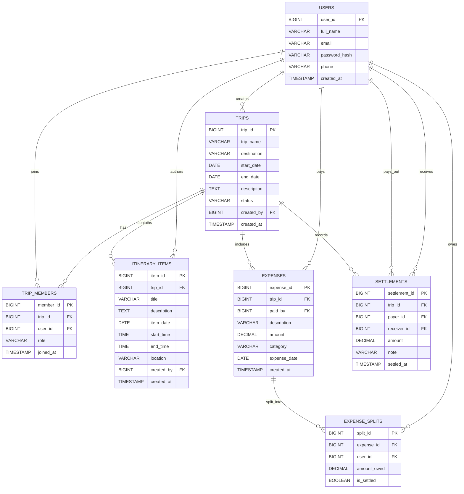
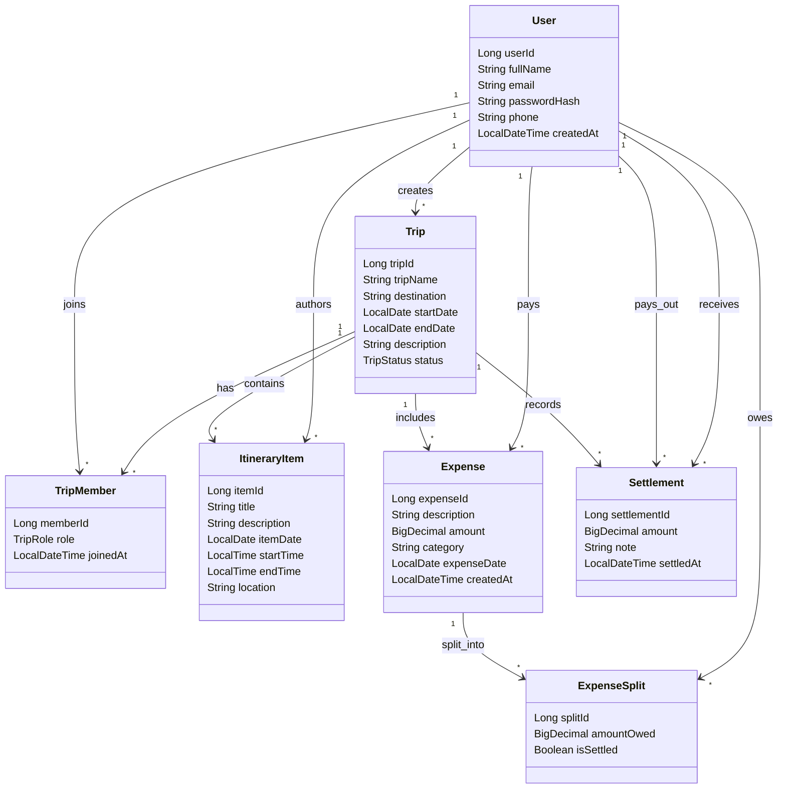
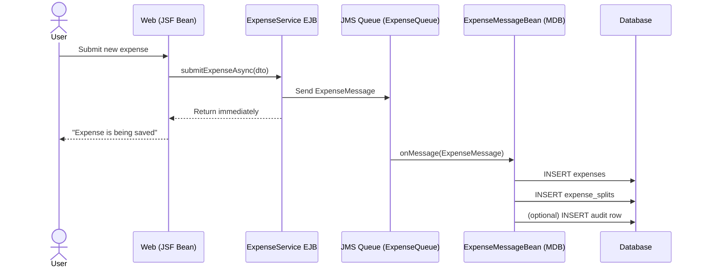
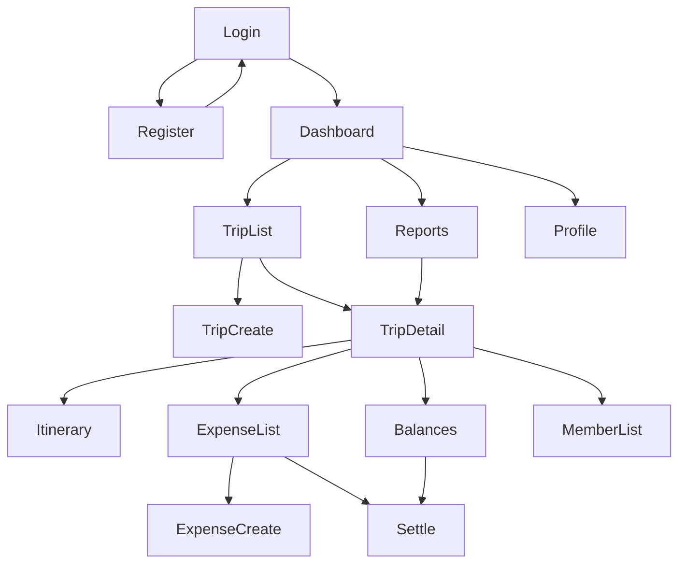
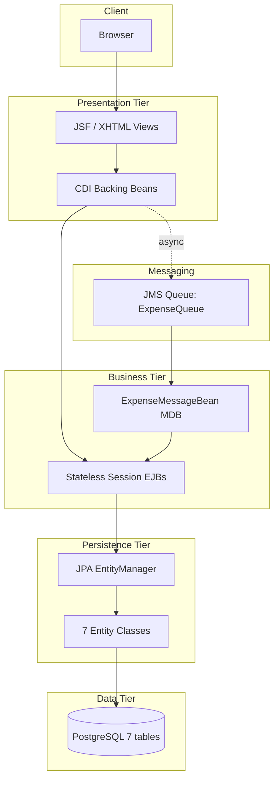
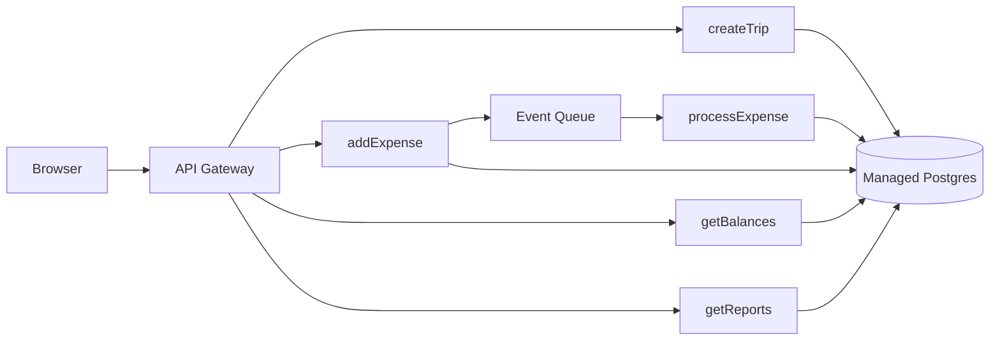

# TripMate — Complete Project Roadmap

Below is the full `roadmap.md` for TripMate. It's structured to serve as your single source of truth — you'll use it to build the app, write the report, and prepare for your viva. It is deliberately mapped to every line of your assignment brief.

---

```markdown
# TripMate — Group Trip Planning & Expense Tracking System

> **Project type:** Distributed Enterprise Web Application  
> **Architecture:** N-Tier Jakarta EE  
> **Backend:** EJB + JPA + JMS/MDB  
> **Database:** PostgreSQL  
> **Frontend:** JSF / Jakarta Faces  
> **Application Server:** GlassFish / Payara  
> **Build tool:** Maven  
> **Assignment:** Designing Serverless Architectures (40) + Design, Documentation & Implementation (60)  
> **Total marks:** 100

---

## 1. Project Vision

### 1.1 Problem Statement

Groups of friends, families, and colleagues frequently travel together. During and after these trips, they face a recurring set of coordination problems:

- Nobody remembers who paid for what.
- Splitting costs fairly becomes an argument.
- Settling debts is awkward and error-prone.
- Itineraries live scattered across WhatsApp messages, notes apps, and email threads.
- There is no single place where the trip's plan and financial state are visible.

Existing tools are fragmented. Messaging apps handle chat but not money. Spreadsheets handle money but not the plan. Notes apps handle the plan but not the group. Nothing ties them together for a **small, trusted group of travellers**.

### 1.2 Proposed Solution

**TripMate** is a web-based enterprise application that lets a group of users:

- Create a trip and invite members.
- Build a shared day-by-day itinerary.
- Log expenses as they happen, splitting them among any subset of members.
- Automatically calculate who owes whom at any point in time.
- Record settlements when debts are paid.
- See a clear summary of trip spending by category and by member.

The system is implemented using a **multi-tier enterprise architecture** to separate presentation, business logic, persistence, and data storage, and uses **asynchronous messaging** for expense creation so that the client is not blocked by multi-record writes.

### 1.3 Why TripMate

TripMate is deliberately chosen so that:

1. It solves a **real, recurring problem** that the author and peers actually experience.
2. It can be **deployed and shared** with friend groups after submission.
3. Its domain naturally requires **complex relational queries** (balance calculation, category aggregation).
4. Its domain naturally justifies **message-driven processing** (decoupled multi-record writes).
5. It provides a **commercial-context narrative** for the CLO3 component: a SaaS platform for group travel finance and planning.

---

## 2. Assignment Compliance Matrix

This table maps each assignment requirement to the TripMate feature that satisfies it. It should appear early in the final report.

| Assignment Requirement | TripMate Implementation | Where |
|---|---|---|
| Database of 3+ linked tables | **7 linked tables** | §5 |
| Entity classes for tables | **7 JPA entities** | §6 |
| DTOs sent to client across network | **8 DTOs** | §7 |
| Session facade bean(s) with remote interface | **5 stateless session EJBs, each with a @Remote interface** | §8 |
| Create and return records from each table | CRUD operations for all 7 tables | §8 |
| 3 EJB queries navigating to a related entity | Queries 1–3 | §9.1–9.3 |
| 2 complex EJB queries navigating 3+ related entities | Queries 4–5 | §9.4–9.5 |
| Message bean updating a table from client request | `ExpenseMessageBean` (MDB) | §10 |
| Web-based GUI client | JSF/XHTML web module | §11 |
| Report with table descriptions, ERD, class diagram, screenshots | `docs/report.md` | §14 |
| Part One: serverless evaluation (~1200 words) | `docs/serverless-report.md` | §15 |
| Wireframe viva (customer requirement validation) | Wireframes in §12 | §12 |
| N-tier prototype demonstration | Live demo in viva | §16 |

---

## 3. Scope

### 3.1 In Scope (Version 1)

- User registration and login (simple form-based authentication).
- Trip creation and member invitation.
- Shared itinerary (add/edit/delete items).
- Expense logging with custom splits (equal or manual).
- Automatic balance calculation per trip.
- Settlement recording.
- Per-trip and cross-trip reporting.
- Asynchronous expense creation via JMS.
- Web-based GUI for all of the above.

### 3.2 Out of Scope (Version 1)

These are explicitly **future enhancements** and are mentioned in §17:

- Real-time chat between members.
- Photo and document uploads.
- Mobile native apps.
- Payment gateway integration.
- SMS/email notification delivery.
- Multi-currency conversion.
- Offline mode.
- Advanced analytics or ML.

### 3.3 Explicitly Not Included

- Anything requiring file storage (S3, etc.) — beyond the assignment scope.
- Third-party OAuth login — adds complexity without adding marks.

---

## 4. Target Users

| Role | Description | Primary Actions |
|---|---|---|
| **Registered User** | Any traveller using TripMate | Create trips, join trips, add expenses, view balances |
| **Trip Admin** | User who created the trip | All member actions + invite/remove members + edit trip |
| **Trip Member** | User invited to a trip | View itinerary, add expenses, view balances, settle up |

> **Note:** Role is per-trip, not global. A user can be admin of one trip and member of another.

---

## 5. Database Design

### 5.1 Overview

TripMate uses **7 linked tables**. This exceeds the minimum of 3, gives the 2 complex queries enough entities to navigate, and keeps the schema understandable.

```
users
trips
trip_members
itinerary_items
expenses
expense_splits
settlements
```

### 5.2 Table: `users`

| Column | Type | Constraint |
|---|---|---|
| user_id | BIGSERIAL | PK |
| full_name | VARCHAR(100) | NOT NULL |
| email | VARCHAR(150) | UNIQUE, NOT NULL |
| password_hash | VARCHAR(255) | NOT NULL |
| phone | VARCHAR(20) | |
| created_at | TIMESTAMP | DEFAULT NOW() |

### 5.3 Table: `trips`

| Column | Type | Constraint |
|---|---|---|
| trip_id | BIGSERIAL | PK |
| trip_name | VARCHAR(150) | NOT NULL |
| destination | VARCHAR(150) | |
| start_date | DATE | |
| end_date | DATE | |
| description | TEXT | |
| status | VARCHAR(30) | NOT NULL (PLANNING/ONGOING/COMPLETED/CANCELLED) |
| created_by | BIGINT | FK → users.user_id |
| created_at | TIMESTAMP | DEFAULT NOW() |

### 5.4 Table: `trip_members`

| Column | Type | Constraint |
|---|---|---|
| member_id | BIGSERIAL | PK |
| trip_id | BIGINT | FK → trips.trip_id |
| user_id | BIGINT | FK → users.user_id |
| role | VARCHAR(20) | NOT NULL (ADMIN/MEMBER) |
| joined_at | TIMESTAMP | DEFAULT NOW() |

**Constraint:** `UNIQUE (trip_id, user_id)` — a user can join a trip only once.

### 5.5 Table: `itinerary_items`

| Column | Type | Constraint |
|---|---|---|
| item_id | BIGSERIAL | PK |
| trip_id | BIGINT | FK → trips.trip_id |
| title | VARCHAR(200) | NOT NULL |
| description | TEXT | |
| item_date | DATE | NOT NULL |
| start_time | TIME | |
| end_time | TIME | |
| location | VARCHAR(200) | |
| created_by | BIGINT | FK → users.user_id |
| created_at | TIMESTAMP | DEFAULT NOW() |

### 5.6 Table: `expenses`

| Column | Type | Constraint |
|---|---|---|
| expense_id | BIGSERIAL | PK |
| trip_id | BIGINT | FK → trips.trip_id |
| paid_by | BIGINT | FK → users.user_id |
| description | VARCHAR(255) | NOT NULL |
| amount | DECIMAL(12,2) | NOT NULL |
| category | VARCHAR(50) | |
| expense_date | DATE | NOT NULL |
| created_at | TIMESTAMP | DEFAULT NOW() |

### 5.7 Table: `expense_splits`

| Column | Type | Constraint |
|---|---|---|
| split_id | BIGSERIAL | PK |
| expense_id | BIGINT | FK → expenses.expense_id |
| user_id | BIGINT | FK → users.user_id |
| amount_owed | DECIMAL(12,2) | NOT NULL |
| is_settled | BOOLEAN | DEFAULT FALSE |

### 5.8 Table: `settlements`

| Column | Type | Constraint |
|---|---|---|
| settlement_id | BIGSERIAL | PK |
| trip_id | BIGINT | FK → trips.trip_id |
| payer_id | BIGINT | FK → users.user_id |
| receiver_id | BIGINT | FK → users.user_id |
| amount | DECIMAL(12,2) | NOT NULL |
| note | VARCHAR(255) | |
| settled_at | TIMESTAMP | DEFAULT NOW() |

### 5.9 ER Diagram



### 5.10 Sample Data Strategy

You will seed the database with:

- 5 users
- 3 trips (one PLANNING, one ONGOING, one COMPLETED)
- ~12 trip_members rows (varying group sizes)
- ~15 itinerary_items
- ~25 expenses across trips
- ~80 expense_splits
- ~6 settlements

This gives you enough data to demonstrate complex queries meaningfully (not just 2 rows per table).

---

## 6. JPA Entity Design

### 6.1 Entities

| Entity | Table |
|---|---|
| `User` | users |
| `Trip` | trips |
| `TripMember` | trip_members |
| `ItineraryItem` | itinerary_items |
| `Expense` | expenses |
| `ExpenseSplit` | expense_splits |
| `Settlement` | settlements |

### 6.2 Relationships

```java
// User
@OneToMany(mappedBy = "createdBy")   List<Trip> createdTrips;
@OneToMany(mappedBy = "user")        List<TripMember> memberships;
@OneToMany(mappedBy = "paidBy")      List<Expense> paidExpenses;
@OneToMany(mappedBy = "user")        List<ExpenseSplit> splits;

// Trip
@ManyToOne                           User createdBy;
@OneToMany(mappedBy = "trip")        List<TripMember> members;
@OneToMany(mappedBy = "trip")        List<ItineraryItem> itineraryItems;
@OneToMany(mappedBy = "trip")        List<Expense> expenses;
@OneToMany(mappedBy = "trip")        List<Settlement> settlements;

// TripMember
@ManyToOne                           Trip trip;
@ManyToOne                           User user;

// ItineraryItem
@ManyToOne                           Trip trip;
@ManyToOne                           User createdBy;

// Expense
@ManyToOne                           Trip trip;
@ManyToOne                           User paidBy;
@OneToMany(mappedBy = "expense",
           cascade = CascadeType.ALL,
           orphanRemoval = true)     List<ExpenseSplit> splits;

// ExpenseSplit
@ManyToOne                           Expense expense;
@ManyToOne                           User user;

// Settlement
@ManyToOne                           Trip trip;
@ManyToOne                           User payer;
@ManyToOne                           User receiver;
```

### 6.3 UML Class Diagram



---

## 7. Data Transfer Objects

The assignment requires DTOs that can be sent to a client across a network. TripMate uses DTOs for every remote boundary crossing.

| DTO | Purpose | Fields |
|---|---|---|
| `UserDTO` | Transfer user profile | userId, fullName, email, phone |
| `TripDTO` | Transfer trip summary | tripId, tripName, destination, startDate, endDate, status, adminName, memberCount |
| `TripMemberDTO` | Transfer member info | memberId, userId, fullName, role, joinedAt |
| `ItineraryItemDTO` | Transfer itinerary item | itemId, title, description, itemDate, startTime, endTime, location, authorName |
| `ExpenseDTO` | Transfer expense with splits | expenseId, tripId, paidByName, description, amount, category, expenseDate, List<SplitDTO> |
| `SplitDTO` | Nested in ExpenseDTO | userId, userName, amountOwed, isSettled |
| `MemberBalanceDTO` | Result of complex query 1 | userId, fullName, totalPaid, totalOwed, netBalance |
| `CategorySpendingDTO` | Result of complex query 2 | category, totalSpent, tripCount |

> **Why DTOs?** In the viva: *"DTOs decouple the web tier from JPA entities, avoid lazy-loading exceptions during serialization, and allow the server to send only the fields the client needs."*

---

## 8. EJB (Business Tier) Design

### 8.1 Session Beans

TripMate uses **5 stateless session beans**, each with a **@Remote** interface. Stateless is appropriate because no business operation requires conversational state across multiple requests.

| EJB | Responsibility |
|---|---|
| `UserService` | Register, login, lookup users |
| `TripService` | CRUD trips, manage members, list user's trips |
| `ItineraryService` | CRUD itinerary items per trip |
| `ExpenseService` | CRUD expenses, record settlements, delegate async creation to JMS |
| `ReportService` | Complex analytics queries (balances, category spending) |

### 8.2 Remote Interfaces (Examples)

```java
@Remote
public interface TripServiceRemote {
    TripDTO createTrip(TripDTO trip, Long creatorId);
    TripDTO getTrip(Long tripId);
    List<TripDTO> getTripsForUser(Long userId);
    List<TripMemberDTO> getTripMembers(Long tripId);
    TripMemberDTO addMember(Long tripId, Long userId, TripRole role);
    void removeMember(Long tripId, Long userId);
    TripDTO updateTrip(TripDTO trip);
}
```

```java
@Remote
public interface ExpenseServiceRemote {
    void submitExpenseAsync(ExpenseDTO expense);   // sends JMS message
    ExpenseDTO getExpense(Long expenseId);
    List<ExpenseDTO> getExpensesForTrip(Long tripId);
    SettlementDTO recordSettlement(SettlementDTO settlement);
    List<SettlementDTO> getSettlementsForTrip(Long tripId);
}
```

```java
@Remote
public interface ReportServiceRemote {
    List<MemberBalanceDTO> getMemberBalances(Long tripId);
    List<CategorySpendingDTO> getCategorySpendingForUser(Long userId);
}
```

### 8.3 Business Rules Enforced in the EJB Layer

Business-critical rules live in the business tier, not the UI:

- A user cannot be added to a trip twice.
- An expense amount must be > 0.
- The sum of `expense_splits.amount_owed` must equal `expense.amount`.
- A settlement must reference two different users.
- A user can only add expenses to trips they belong to.
- Only trip admins can remove members.

---

## 9. JPQL Queries

### 9.1 Query 1 — Itinerary items for a trip (navigates to `Trip`)

```jpql
SELECT i
FROM ItineraryItem i
WHERE i.trip.tripId = :tripId
ORDER BY i.itemDate ASC, i.startTime ASC
```

Used by: Trip Detail page → Itinerary tab.

### 9.2 Query 2 — Expenses for a trip (navigates to `Trip`)

```jpql
SELECT e
FROM Expense e
WHERE e.trip.tripId = :tripId
ORDER BY e.expenseDate DESC
```

Used by: Trip Detail page → Expenses tab.

### 9.3 Query 3 — Trips a user belongs to (navigates to `TripMember` and `User`)

```jpql
SELECT t
FROM Trip t
JOIN t.members m
WHERE m.user.userId = :userId
ORDER BY t.startDate DESC
```

Used by: Dashboard → "My Trips".

### 9.4 Complex Query 1 — Net balance per member of a trip (navigates 4 entities)

Navigates: `TripMember` → `User` (and subqueries over `Expense` and `ExpenseSplit`).

```jpql
SELECT new com.tripmate.dto.MemberBalanceDTO(
    u.userId,
    u.fullName,
    (SELECT COALESCE(SUM(e.amount), 0)
     FROM Expense e
     WHERE e.paidBy = u AND e.trip.tripId = :tripId),
    (SELECT COALESCE(SUM(es.amountOwed), 0)
     FROM ExpenseSplit es
     WHERE es.user = u AND es.expense.trip.tripId = :tripId)
)
FROM TripMember tm
JOIN tm.user u
WHERE tm.trip.tripId = :tripId
ORDER BY u.fullName
```

The service then computes `netBalance = totalPaid − totalOwed` before returning.

Used by: Trip Detail page → Balances tab.

### 9.5 Complex Query 2 — Category spending across a user's trips (navigates 4 entities)

Navigates: `ExpenseSplit` → `Expense` → `Trip` → `TripMember`.

```jpql
SELECT new com.tripmate.dto.CategorySpendingDTO(
    e.category,
    SUM(es.amountOwed),
    COUNT(DISTINCT e.trip.tripId)
)
FROM ExpenseSplit es
JOIN es.expense e
JOIN e.trip t
JOIN t.members tm
WHERE tm.user.userId = :userId
GROUP BY e.category
ORDER BY SUM(es.amountOwed) DESC
```

Used by: Reports page → "Where Your Money Went".

### 9.6 Query Compliance Check

| Requirement | Query |
|---|---|
| 3 queries navigating to a related entity | Q1 (ItineraryItem → Trip), Q2 (Expense → Trip), Q3 (Trip → TripMember → User) |
| 2 complex queries navigating 3+ entities | Q4 (TripMember/User/Expense/ExpenseSplit), Q5 (ExpenseSplit/Expense/Trip/TripMember) |

---

## 10. Message-Driven Bean

### 10.1 Rationale

When a user adds an expense, TripMate must:

1. Insert one `expenses` row.
2. Insert N `expense_splits` rows (one per participant).
3. Optionally update cached balances / trigger notifications later.

This is a **multi-record write** that does not need to block the HTTP response. Sending an expense request as a JMS message:

- Decouples the web tier from the persistence work.
- Allows future extension (notification, analytics, fraud checks) without changing the client.
- Demonstrates a genuine enterprise-messaging use case.

### 10.2 Message Flow



### 10.3 MDB Skeleton

```java
@MessageDriven(
    activationConfig = {
        @ActivationConfigProperty(
            propertyName = "destinationLookup",
            propertyValue = "java:jboss/exported/jms/queue/ExpenseQueue"),
        @ActivationConfigProperty(
            propertyName = "destinationType",
            propertyValue = "jakarta.jms.Queue")
    }
)
public class ExpenseMessageBean implements MessageListener {

    @EJB private ExpenseServiceRemote expenseService;

    @Override
    public void onMessage(Message message) {
        try {
            ExpenseMessage payload = message.getBody(ExpenseMessage.class);
            expenseService.persistExpense(payload);
        } catch (JMSException ex) {
            throw new RuntimeException(ex);
        }
    }
}
```

### 10.4 Assignment Compliance

The requirement is: *"A message bean which updates a table from a client request."* This MDB updates the `expenses` and `expense_splits` tables in response to a client-submitted message. Compliance satisfied.

---

## 11. Web (Presentation) Tier

### 11.1 Technology

- **Jakarta Server Faces (JSF) 4.0** with XHTML views.
- **CDI backing beans** (`@Named`, `@ViewScoped`, `@SessionScoped`).
- **PrimeFaces** for UI components (data tables, dialogs, charts).
- **Bootstrap 5** for layout and styling.

> JSF is chosen because it is the standard Jakarta EE web framework, it integrates natively with EJB, and it allows the assignment's "JSPs/JSFs, Servlets etc." requirement to be satisfied cleanly.

### 11.2 Page Inventory

| # | Page | Purpose |
|---|---|---|
| 1 | `login.xhtml` | Login form |
| 2 | `register.xhtml` | New user registration |
| 3 | `dashboard.xhtml` | Summary: my trips, total spent, recent activity |
| 4 | `trips/list.xhtml` | All trips I'm part of |
| 5 | `trips/create.xhtml` | Create a new trip |
| 6 | `trips/detail.xhtml` | Trip overview: itinerary tab, expenses tab, balances tab, members tab |
| 7 | `trips/itinerary.xhtml` | Add/edit itinerary items |
| 8 | `trips/expenses.xhtml` | Add expense, list expenses |
| 9 | `trips/balances.xhtml` | Net balance per member (complex query 1) |
| 10 | `trips/settle.xhtml` | Record a settlement |
| 11 | `reports/index.xhtml` | Category spending chart (complex query 2) |
| 12 | `profile.xhtml` | User profile |

### 11.3 Navigation Chart



### 11.4 Responsive Behaviour

The breakpoints are 744, 1024 and 1440 pixels, and the interesting question at each is what
happens to a table, because a data application is mostly tables.

| Width | What changes |
| --- | --- |
| Under 744px | The navigation collapses into an off-canvas panel opened by a menu button. Tables become stacked cards, one per row, each field labelled by its own column header. Multi-column forms become one column. Charts drop their label density. |
| 744 to 1023px | The navigation keeps its links and drops the account name. Tables keep their columns and scroll inside their own wrapper rather than dragging the page. Forms use two columns. |
| 1024px and above | Full navigation, two-column page layouts, charts beside their tables. |
| 1440px and above | Content caps at 1280px and the gutters absorb the rest. |

Two rules hold at every width: **the page never scrolls horizontally**, and **every
interactive target is at least 44 by 44 pixels**. Both were measured rather than eyeballed,
by reading `scrollWidth` against `innerWidth` and listing any element extending past the
viewport.

### 11.5 Accessibility

| Concern | Approach |
| --- | --- |
| Keyboard | A skip link is the first tab stop on every page. Focus is visible on every stop, verified by tabbing through the application. |
| Focus rings | A ring is drawn for `:focus-visible` only, so a mouse click leaves nothing behind and a keyboard user keeps the indicator. |
| Colour | Contrast is at least 4.5:1 for text. The chart palette was chosen by validating candidate orderings for colourblind separation, and every chart carries a legend and a table of the same figures, so identity is never carried by colour alone. |
| State | Every status chip carries an icon or a dot and a word, not only a tint. |
| Motion | All durations collapse under `prefers-reduced-motion: reduce`; the state change still happens. |
| Screen readers | Toasts are announced with a role that matches their severity. The closed navigation panel is removed from the accessibility tree rather than merely moved off-screen. |
| Forms | Every field has a visible label, and validation messages render beside the field they belong to. |

### 11.6 Wireframes (for the Wireframe Viva)

The viva for "Customer Requirement Validation" requires wireframes. Include **5 wireframes** in the report:

1. Login / Register
2. Dashboard
3. Trip Detail (with tabs)
4. Add Expense (with split editor)
5. Balances / Settle Up

Each wireframe should have a short paragraph explaining the user goal it serves.

---

## 12. System Architecture

### 12.1 N-Tier Diagram



### 12.2 Inter-Tier Contracts

| From → To | Contract |
|---|---|
| Browser → JSF | HTTP/HTTPS |
| JSF Backing Bean → EJB | Remote EJB call (RMI/IIOP) |
| EJB → JPA | Local (in-container) |
| JPA → PostgreSQL | JDBC |
| Backing Bean → JMS Queue | JMS |
| JMS Queue → MDB | JMS |
| MDB → EJB | Local EJB call |

---

## 13. Project Structure (Maven Multi-Module)

```
TripMate/
├── pom.xml                      # Parent POM
│
├── tripmate-ejb/
│   ├── pom.xml
│   └── src/main/java/com/tripmate/
│       ├── entity/              # 7 JPA entities
│       ├── dto/                 # 8 DTOs
│       ├── remote/              # 5 @Remote interfaces
│       ├── ejb/                 # 5 session bean implementations
│       └── messaging/           # ExpenseMessageBean + ExpenseMessage
│   └── src/main/resources/META-INF/persistence.xml
│
├── tripmate-web/
│   ├── pom.xml
│   └── src/main/
│       ├── java/com/tripmate/web/
│       │   ├── backing/         # CDI backing beans
│       │   └── util/            # JSF helpers, session util
│       └── webapp/
│           ├── index.xhtml
│           ├── login.xhtml
│           ├── register.xhtml
│           ├── dashboard.xhtml
│           ├── trips/           # list, create, detail, itinerary, expenses, balances, settle
│           ├── reports/
│           ├── profile.xhtml
│           ├── resources/css/
│           └── WEB-INF/
│
├── tripmate-ear/
│   └── pom.xml                  # Packages EJB + WAR into EAR
│
├── database/
│   ├── schema.sql
│   ├── seed.sql
│   └── reset.sql
│
├── docs/
│   ├── roadmap.md               # this file
│   ├── report.md                # Part Two design report
│   ├── serverless-report.md     # Part One evaluation report
│   ├── wireframes/              # PNG/SVG wireframes
│   ├── diagrams/                # exported ERD, UML, architecture
│   └── screenshots/             # captured during testing
│
└── README.md
```

---

## 14. Implementation Phases

Each phase ends with a **verifiable milestone**. Do not skip ahead.

### Phase 0 — Environment Setup
- Install JDK 17, Maven, PostgreSQL, GlassFish/Payara, IntelliJ or NetBeans.
- Verify a "Hello Enterprise" EAR deploys successfully.
- **Milestone:** Empty EAR runs on GlassFish.

### Phase 1 — Database
- Write `schema.sql` (7 tables).
- Write `seed.sql` (realistic sample data).
- Run against PostgreSQL and verify with SQL queries.
- **Milestone:** All 7 tables exist with sample data.

### Phase 2 — JPA Entities
- Create 7 entity classes with relationships.
- Configure `persistence.xml`.
- Write a small test that reads and writes each entity.
- **Milestone:** Entities round-trip against PostgreSQL.

### Phase 3 — DTOs
- Create 8 DTO classes.
- Add mapping methods (entity → DTO).
- **Milestone:** DTOs compile; mapping tested.

### Phase 4 — Session Beans (CRUD)
- Implement all 5 session beans with **basic CRUD** first.
- Remote interfaces wired.
- **Milestone:** EJB methods callable and returning data.

### Phase 5 — The 5 Required Queries
- Implement Q1–Q3 (simple) and Q4–Q5 (complex).
- Test each in isolation against seed data.
- **Milestone:** All 5 queries return correct, verified results.

### Phase 6 — Web Tier
- Set up JSF, PrimeFaces, CDI.
- Build pages 1–12 in order: login → dashboard → trips → expenses.
- **Milestone:** Full CRUD usable from browser.

### Phase 7 — Messaging (JMS + MDB)
- Configure a JMS queue on the app server.
- Create `ExpenseMessage` and `ExpenseMessageBean`.
- Modify `ExpenseService.submitExpenseAsync()` to send messages.
- Modify the web tier to call the async method.
- **Milestone:** Expense saved via MDB (verified in logs and DB).

### Phase 8 — Complex UI Features
- Balances tab (Q4).
- Category spending chart (Q5).
- Settle up flow.
- **Milestone:** Both complex queries visible in UI.

### Phase 9 — Business Rules & Validation
- Implement all §8.3 rules in the EJB layer.
- Add JSF input validation.
- **Milestone:** Invalid operations rejected at business tier.

### Phase 10 — Testing
- Execute the test matrix (§16.2).
- Capture screenshots for report.
- **Milestone:** All tests pass; screenshots stored.

### Phase 11 — Report & Part One
- Write `report.md` (Part Two design document).
- Write `serverless-report.md` (Part One, ~1200 words).
- Export diagrams.
- **Milestone:** Reports complete in `.md`.

### Phase 12 — Deployment & Viva Prep
- Package EAR.
- Deploy to GlassFish cleanly.
- Rehearse the demo scenario (§16.3).
- Prepare viva answers (§18).
- **Milestone:** Confident demo.

### Phase 13 — Delivery
- Extend `DESIGN.md` with semantic states, a three-tier elevation scale, gradients, a
  motion scale and a validated chart palette.
- Rebuild the application shell: responsive navigation, a footer that sits at the bottom,
  per-page metadata, generated icons.
- Rebuild the form controls: date picker, select, and one focus policy.
- Add the feedback layer: toasts, one confirmation dialog, empty and error states.
- Make tables sortable, and turn each row into a labelled card below the mobile breakpoint.
- Rework every page onto the new shell and components.
- Add status and state chips, so a trip's lifecycle and a balance's direction are readable
  at a glance.
- **Milestone:** The application presents as a product. (`docs/phase-13-delivery.md`)

### Phase 14 — Notifications, Invitations and Security
- Add transactional email, with a logging fallback when no SMTP host is configured.
- Replace the member picker with an exact-email invitation, and add promote, demote and
  leave so the last-administrator rule is followable.
- Add forgotten-password, with hashed single-use tokens and a reply that does not reveal
  whether an address has an account.
- Email everyone a closing summary of a trip.
- Close the authorization gaps in the itinerary, report and user services, rotate the
  session id on sign-in, and stop rendering raw failures into the page.
- **Milestone:** The application can reach the people who use it, and refuse the people who
  should not. (`docs/phase-14-notifications-and-security.md`, `docs/phase-15-security.md`)

---

## 15. Part One — Serverless Evaluation Report (40 Marks)

Part One is independent of TripMate but should use TripMate as its **running example**. Structure:

### 15.1 Required Sections (per assignment brief)

1. **Introduction** (~100 words)
2. **Serverless Architectures** (~250 words)
   - Definition, FaaS, BaaS, event-driven model.
   - Cold starts, statelessness, execution limits.
   - Examples: AWS Lambda, Azure Functions, Cloudflare Workers.
3. **Role of Serverless in Enterprise Systems** (~250 words)
   - Where it fits: variable workloads, event-driven pipelines, scheduled jobs.
   - Where it does not: long-running processes, stateful sessions, high-throughput steady loads.
4. **Server-Based Architectures** (~250 words)
   - Traditional N-tier, containers, VMs, Java EE servers.
   - Reference TripMate's actual stack (GlassFish + EJBs + JPA + PostgreSQL).
5. **Comparison** (~200 words + diagrams)
   - Cost, scalability, operations, latency, portability, vendor lock-in.
   - Include two diagrams: server-based TripMate vs hypothetical serverless TripMate.
6. **Justification for Serverless Adoption in Optimizing Economics** (~150 words)
   - When serverless is economically superior.
   - When it is not.
   - Balanced, evidence-based conclusion.

### 15.2 Serverless TripMate (Hypothetical)



Compare this with §12.1 (your actual stack) in the report.

### 15.3 Deliverable Format

- File: `docs/serverless-report.md`
- Length: ~1200 words (±10%)
- Include at least **2 diagrams** and **1 comparison table**.
- Use academic references (AWS docs, Azure docs, peer-reviewed papers on serverless economics).

---

## 16. Testing Strategy

### 16.1 Test Layers

| Layer | What | Tool |
|---|---|---|
| Unit | Business rules in EJBs | JUnit 5 + Jakarta EE test container |
| Integration | EJB → JPA → PostgreSQL | Arquillian or manual test servlet |
| UI | JSF pages | Manual walkthrough with test matrix |
| Messaging | JMS → MDB → DB | Manual test + log inspection |
| Acceptance | End-to-end trip scenario | Rehearsed demo |

### 16.2 Test Matrix

| # | Test | Expected Result |
|---|---|---|
| 1 | Register a new user | User persisted; login works |
| 2 | Login with wrong password | Rejected |
| 3 | Create a trip | Trip + admin membership created |
| 4 | Add a member to a trip | Membership row created |
| 5 | Add duplicate member | Rejected |
| 6 | Add itinerary item | Persisted; appears in itinerary tab |
| 7 | Add expense with equal split | Expense + N splits created asynchronously |
| 8 | Add expense with unequal split | Splits match custom amounts |
| 9 | Expense with splits sum ≠ amount | Rejected by business rule |
| 10 | View balances | Q4 returns correct net balances |
| 11 | Record settlement | Settlement persisted; balances reflect it |
| 12 | View category report | Q5 returns aggregated spending |
| 13 | Non-member tries to add expense | Rejected |
| 14 | Remove member as non-admin | Rejected |
| 15 | JMS message processed | `expenses` and `expense_splits` rows created |
| 16 | Cold deploy on clean DB | All tables created, app functional |

### 16.3 Demo Scenario (for Viva)

Rehearse this exact flow:

1. Log in as **Alice**.
2. Open the trip **"Pokhara Weekend"**.
3. Show the itinerary tab.
4. Add a new expense: **"Dinner at Lakeside" — NPR 4,800 — split among 4 members**.
5. Show that the expense appears via async processing (check DB or refresh).
6. Open the **Balances** tab — show net balances.
7. Open **Settle Up** — record Bob paying Alice NPR 1,200.
8. Refresh balances — Bob's net position improves.
9. Open **Reports** — show category spending chart.
10. Log out.

**Narrative:** *"This is a real workflow my friends and I would use on a trip. The system handles coordination and finance in one place, and the async expense creation keeps the UI responsive while the server does the multi-record write."*

---

## 17. Limitations & Future Enhancements

### 17.1 Known Limitations (V1)

- Password reset not implemented.
- No email/SMS notifications (message infrastructure exists but delivery is future work).
- No multi-currency support.
- No mobile client.
- No file uploads (photos/receipts).
- Single-instance deployment only (no clustering).

### 17.2 Future Enhancements

- Receipt image upload with OCR.
- SMS/email notifications via the existing MDB pipeline.
- Multi-currency with historical FX rates.
- Push notifications via mobile app.
- Serverless deployment of the reporting pipeline (ties to Part One).
- AI-assisted itinerary suggestions.

---

## 18. Viva Preparation

### 18.1 Likely Questions & Model Answers

**Q: Why N-tier?**  
A: Separation of concerns. The web tier only handles presentation; the EJB tier holds business rules; the persistence tier manages entity mapping; the database stores data. Each tier can evolve independently and be tested in isolation.

**Q: Why stateless session beans?**  
A: No business operation requires conversational state across requests. Stateless beans allow the container to pool and reuse instances, improving scalability.

**Q: Why DTOs instead of entities across the remote boundary?**  
A: To avoid exposing persistence details, to prevent lazy-loading exceptions during serialization, and to send only the fields the client actually needs.

**Q: Why JPQL instead of SQL?**  
A: JPQL queries the entity model rather than tables, so the code is database-independent and can navigate relationships using object paths (`e.trip.tripId`).

**Q: Why a message-driven bean for expenses?**  
A: Expense creation is a multi-record write. Doing it asynchronously decouples the client from persistence work and gives us a natural extension point for future notifications and analytics.

**Q: How do you prevent a user from joining a trip twice?**  
A: A `UNIQUE (trip_id, user_id)` constraint in the database, plus a business-rule check in `TripService` before insertion.

**Q: Where does validation belong?**  
A: UI validation is for user experience. Business-critical validation must live in the business tier because clients cannot be trusted to enforce rules.

**Q: Would serverless be cheaper for TripMate?**  
A: It depends. For a small friend group with bursty usage, serverless would likely be cheaper due to scale-to-zero. For a steady high-volume SaaS with many concurrent users, provisioned infrastructure can be more economical. This is analysed in Part One.

**Q: How would you commercialize TripMate?**  
A: As a SaaS platform for small travel groups — free for up to 3 trips, paid tiers for larger groups, integrations, and analytics. The commercial framing is in the report's System Proposal.

### 18.2 Diagrams to Have Ready

- N-tier architecture (§12.1)
- ER diagram (§5.9)
- UML class diagram (§6.3)
- Navigation chart (§11.3)
- JMS sequence diagram (§10.2)
- Serverless comparison diagram (§15.2)

### 18.3 Files to Bring to Viva

- Deployed EAR running on GlassFish.
- PostgreSQL with seed data loaded.
- Printed or on-screen wireframes (§11.6).
- This roadmap.
- Both reports.

---

## 19. Deliverables Checklist

Before submission, confirm each item:

- [ ] `tripmate-ejb` module with 7 entities, 8 DTOs, 5 remote interfaces, 5 session beans, 1 MDB.
- [ ] `tripmate-web` module with 12 XHTML pages, backing beans, CSS.
- [ ] `tripmate-ear` module packaging EJB + WAR.
- [ ] `database/schema.sql` and `database/seed.sql`.
- [ ] `docs/report.md` — Part Two design document, with:
  - [ ] Cover page and TOC with page numbers.
  - [ ] System proposal.
  - [ ] Web component design.
  - [ ] Web page design with navigation chart.
  - [ ] Business tier design.
  - [ ] Database access design.
  - [ ] Overview, project plan, UML diagrams, architecture.
  - [ ] Database design with table descriptions and ERD.
  - [ ] References.
- [ ] `docs/serverless-report.md` — Part One (~1200 words) with diagrams.
- [ ] `docs/wireframes/` — 5 wireframes.
- [ ] `docs/diagrams/` — ERD, UML, architecture, navigation, JMS sequence.
- [ ] `docs/screenshots/` — 12 purposeful screenshots with captions.
- [ ] Zipped Enterprise Application project (server + client + report) ready for submission.
- [ ] Demo rehearsed on a clean deployment.

---

## 20. Timeline (Suggested)

| Week | Focus | Deliverable |
|---|---|---|
| 1 | Environment + database + JPA | Schema + entities round-trip |
| 2 | DTOs + EJBs + 5 queries | All queries verified |
| 3 | Web tier (login, dashboard, trips, itinerary) | Usable UI for CRUD |
| 4 | Expenses, JMS, MDB | Async expense creation working |
| 5 | Balances, reports, settlements | Complex queries in UI |
| 6 | Testing, screenshots, reports, viva prep | Submission package complete |

Adjust based on your actual deadline. The critical path is **database → entities → queries → UI → MDB**. Everything else can be parallelized.

---

## 21. Guiding Principle

> **Build TripMate as if you were going to launch it for your own friend group next month. The assignment will be satisfied as a side effect.**

If a design decision makes the app more useful to real users without breaking the assignment requirements, choose it. If it satisfies the assignment but makes the app worse for users, reconsider.
