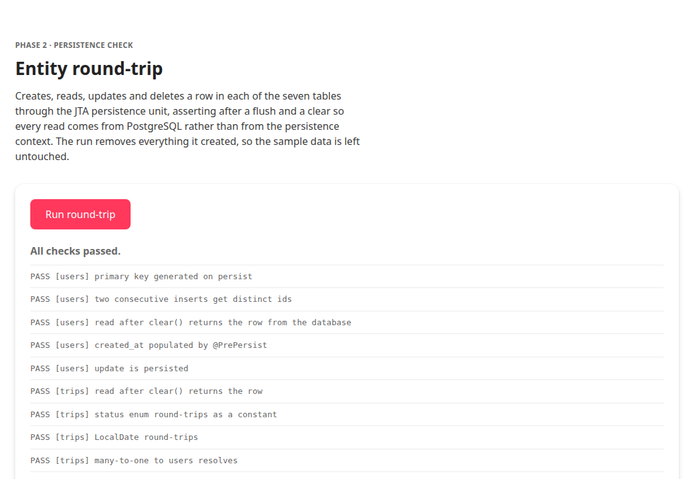

# Phase 2 — JPA Entities

**Status:** complete — milestone met
**Date:** 2026-09-27
**Milestone (ROADMAP §14):** *Entities round-trip against PostgreSQL.*

---

## 1. Deliverables

| File | Purpose |
| --- | --- |
| `tripmate-ejb/.../entity/TripStatus.java` | `PLANNING`, `ONGOING`, `COMPLETED`, `CANCELLED` |
| `tripmate-ejb/.../entity/TripRole.java` | `ADMIN`, `MEMBER` |
| `tripmate-ejb/.../entity/User.java` | `users` |
| `tripmate-ejb/.../entity/Trip.java` | `trips` |
| `tripmate-ejb/.../entity/TripMember.java` | `trip_members` |
| `tripmate-ejb/.../entity/ItineraryItem.java` | `itinerary_items` |
| `tripmate-ejb/.../entity/Expense.java` | `expenses` |
| `tripmate-ejb/.../entity/ExpenseSplit.java` | `expense_splits` |
| `tripmate-ejb/.../entity/Settlement.java` | `settlements` |
| `tripmate-ejb/src/main/resources/META-INF/persistence.xml` | `tripmatePU` JTA persistence unit |
| `scripts/glassfish-setup.sh` | Creates the connection pool and JDBC resource |
| `tripmate-ejb/.../ejb/PersistenceSmokeTest.java` | Round-trip check *(temporary — deleted in Phase 4)* |
| `tripmate-web/.../backing/PersistenceCheckBean.java` | Runs it from the browser *(temporary)* |
| `tripmate-web/src/main/webapp/phase2-check.xhtml` | Result page *(temporary)* |

## 2. Entity design decisions

### 2.1 `allocationSize = 1` on every sequence generator

The one decision in this phase that would have produced a confusing, delayed
failure. The schema's `BIGSERIAL` columns are backed by sequences that increment
by **1**. EclipseLink's default allocation size is **50**: it would hand out ids
1–50 while the sequence advanced only once, so the 51st insert would collide
with the 1st.

This is asserted directly — the smoke test inserts two consecutive rows and
fails if they receive the same id — so the default cannot creep back in.

### 2.2 Every column mapped explicitly

EclipseLink has no snake_case naming strategy. Left to its own devices it looks
for `USERID`, not `user_id`. Every field therefore carries an explicit
`@Column(name = ...)`. Verbose, but unambiguous, and it keeps the mapping honest
against `database/schema.sql` rather than relying on a convention that holds only
by accident.

### 2.3 Collections are LAZY; cascade only where it is earned

All `@OneToMany` associations are `FetchType.LAZY`. Loading a trip must not drag
in every expense, and loading a user must not drag in every trip they have
touched.

Cascade is set in exactly one place — `Expense.splits` gets
`CascadeType.ALL` + `orphanRemoval = true`. A split has no independent
existence; it is a per-person share of one expense, so persisting the expense
should carry it and removing it from the collection should delete its row.

The trip-owned collections deliberately carry **no** JPA cascade. The schema
already has `ON DELETE CASCADE`, so JPA-level cascade would be a second,
competing mechanism for the same job. Two mechanisms where one suffices is how
you get a delete that behaves differently depending on which side initiated it.

### 2.4 Referential actions mirrored as `optional`

`trips.created_by`, `itinerary_items.created_by` and `expenses.paid_by` are
`@ManyToOne(optional = true)` because the schema uses `ON DELETE SET NULL` —
deleting a user must not erase a trip or a financial record. The associations
that are `NOT NULL` in the schema are mapped `optional = false`.

### 2.5 Identity by primary key, hash code constant

Entities compare by id and an unsaved instance never equals anything. The hash
code is a constant per class rather than derived from the id, because an
entity's hash must not change when the database assigns its key — otherwise an
instance already sitting in a `HashSet` becomes unreachable. This matters less
here than in most projects, since DTOs and not entities cross the network, but
it costs nothing to get right.

### 2.6 `@PrePersist` for audit timestamps

The schema has `DEFAULT NOW()` on its timestamp columns, but JPA sends an
explicit `NULL` for an unset field, which overrides the default. `@PrePersist`
sets the value so the in-memory entity and the stored row agree without a
re-read.

### 2.7 DDL generation is off

`eclipselink.ddl-generation = none`. The schema is owned by
`database/schema.sql`. Left at its default, the provider could create or alter
tables at deploy time — silently diverging from the schema the report documents
and dropping the CHECK constraints, partial referential actions and nine
deliberate indexes that no generated DDL would reproduce. With `none`, a
mapping that disagrees with a column produces a loud error instead of a quiet
table rewrite.

## 3. Datasource

`scripts/glassfish-setup.sh` creates the `tripmatePool` connection pool and
`jdbc/tripmate` resource. Two choices worth recording:

- **The JDBC driver lives in the container, not the EAR.** A driver loaded by a
  web application's classloader cannot be shared by the container's pool.
  `postgresql-42.7.3.jar` sits in `domain1/lib`.
- **The pool is pinged after configuration.** Without that, a wrong password or
  a missing database would first show up as a vague deployment failure rather
  than as the precise problem it is.

The script is idempotent and *convergent*: re-running it pushes the current
`TM_DB_*` values into the pool, so repointing the app at a different database is
a matter of editing `scripts/env.sh` and re-running. `deploy.sh` calls it
automatically, because the persistence unit resolves its datasource during
deployment.

## 4. Verification

### 4.1 The round-trip check

`phase2-check.xhtml` runs a 35-assertion round-trip: create, read, update and
delete across all seven tables, including cascade behaviour and the trip
deletion path.

**Every assertion runs after `flush()` followed by `clear()`.** The flush pushes
the SQL to the database; the clear discards the persistence context so the
`find()` and JPQL counts that follow cannot be answered from EclipseLink's
first-level cache. Without the clear a read-back would prove only that the
object graph is in memory, and would pass just as happily against a mistyped
column name.

```
SUMMARY: all 35 checks passed
```



What the checks cover beyond plain CRUD:

- Two consecutive inserts receive **distinct** ids — the `allocationSize` guard.
- `TEXT` columns hold content past any `VARCHAR` limit, so the `columnDefinition`
  mapping is exercised.
- `LocalDate` and `LocalTime` round-trip; `LocalTime` is asserted as a time, not
  as a timestamp.
- Enums round-trip as constants, and an enum update persists.
- `CascadeType.ALL` creates both splits **without either being persisted
  directly**, and the count is taken with JPQL so the answer comes from the
  database.
- The two-level path `s.expense.trip.tripId` resolves, which is the navigation
  the balance query will depend on.
- `Settlement`'s two independent many-to-one associations to `User` resolve to
  two different people.
- Deleting the trip removes memberships, itinerary items, expenses, splits and
  settlements — five cascade checks.
- The users **survive** that deletion, and the three seeded trips are still
  present.

### 4.2 The check was proved non-vacuous

Passing assertions mean nothing if the harness cannot fail. A mapping was
deliberately broken — `Expense.category` pointed at a column named
`category_typo` — and the run failed at the database:

```
Caused by: org.postgresql.util.PSQLException:
  ERROR: column "category_typo" of relation "expenses" does not exist
```

That is the exact class of error this phase exists to catch early. The sabotage
was then reverted.

### 4.3 Zero residue

The round-trip creates its own rows and removes them, so the sample data is
untouched. Counts before and after are identical:

```
users=5 trips=3 members=12 items=15 expenses=25 splits=100 settlements=6
```

and no `smoke-%` rows exist anywhere. `database/verify.sql` still passes.

## 5. Two bugs found and fixed during this phase

Both were caught by actually running the thing rather than by reading it.

### 5.1 `ui:repeat` silently rendered as inert markup

The page declared `xmlns:ui="jakarta.faces.ui"`. That URI does not exist. Rather
than erroring, Faces emitted `<ui:repeat value="[...]" var="line">` as literal
HTML and an empty `<li>`, so the report never appeared.

The correct URI in Faces 4.0 is **`jakarta.faces.facelets`**, confirmed by
reading the namespace out of `com/sun/faces/metadata/taglib/faces.facelets.taglib.xml`
inside `glassfish/modules/jakarta.faces.jar` rather than guessing from an older
JCP-era namespace.

### 5.2 `rendered` on a plain HTML element does nothing

`<p class="tm-error" rendered="#{...}">` looked correct and was not. Facelets
passes `rendered` through as a literal attribute on a plain HTML element — only
Faces *components* honour it — so the element was always emitted. It rendered as
a stray empty grey bar under the summary, since `.tm-error` sets a background
and padding.

This is exactly the kind of bug that survives review: the page looked right in
the passing case apart from a cosmetic gap, and the *failing* case is when it
would matter. Fixed by using `h:panelGroup layout="block"`, a real component.

## 6. Reproducing

```bash
./database/load.sh           # ensure schema and sample data are present
./scripts/glassfish-setup.sh # create pool + JDBC resource, ping it
./scripts/deploy.sh          # build and deploy the EAR
xdg-open http://localhost:8080/tripmate/phase2-check.xhtml
```

`deploy.sh` already runs the datasource step, so in practice `./scripts/deploy.sh`
alone is enough.

## 7. Notes for later phases

- **`PersistenceSmokeTest`, `PersistenceCheckBean` and `phase2-check.xhtml` are
  scaffolding.** Phase 4 deletes all three along with `HelloService`
  (`docs/phase-0-setup.md` §6 already tracks that one), and the link from
  `index.xhtml` goes with them. They exist to make a mapping error loud now
  rather than mysterious later.
- **Constraint violations are not tested here, by design.** A failed flush marks
  the container-managed transaction rollback-only, so the first deliberate
  violation would poison every statement after it. The database constraints are
  covered by the fifteen negative cases in `docs/phase-1-database.md`; the
  business rules that need the EJB tier are Phase 9's job.
- **`Expense.getSplitTotal()` / `isBalanced()` are placed but not yet used.**
  Phase 9's `ExpenseService` is what will call them to enforce the rule that a
  split total equals its expense amount. They are deliberately not enforcement —
  enforcement belongs in the service so the caller gets a readable message
  rather than a failed flush.
- **The `trips.description` TEXT mapping is asserted, not assumed.** The
  smoke test writes 1,200 characters through it, so if the mapping is ever
  changed to a `VARCHAR` the failure is immediate.

---

## 8. Next — Phase 3: DTOs

Eight DTO classes (ROADMAP §7) with entity → DTO mapping, so that no entity ever
crosses the remote boundary.

**Milestone:** DTOs compile; mapping tested.
