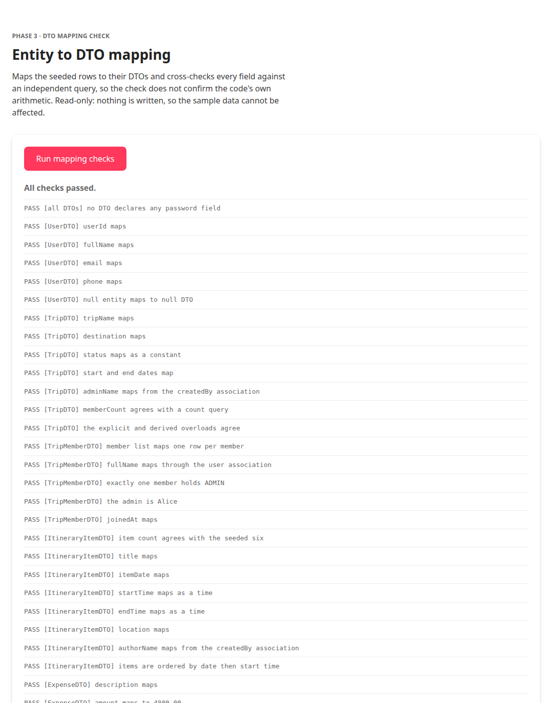

# Phase 3: Data Transfer Objects

**Status:** complete, milestone met
**Date:** 2026-09-27
**Milestone (ROADMAP §14):** *DTOs compile; mapping tested.*

---

## 1. Deliverables

| DTO | Purpose |
| --- | --- |
| `UserDTO` | User profile |
| `TripDTO` | Trip summary with `adminName` and `memberCount` |
| `TripMemberDTO` | One membership, with the role held on that trip |
| `ItineraryItemDTO` | One scheduled activity |
| `ExpenseDTO` | An expense together with its splits |
| `SplitDTO` | One participant's share, nested in `ExpenseDTO` |
| `SettlementDTO` | A recorded repayment between two members |
| `MemberBalanceDTO` | Result of complex query 1 |
| `CategorySpendingDTO` | Result of complex query 2 |

Plus the mapping verification: `DtoMappingSmokeTest`, `DtoCheckBean` and
`phase3-check.xhtml`, all temporary and deleted in Phase 4.

## 2. Nine DTOs, not eight

ROADMAP §7 lists eight DTOs. ROADMAP §8.2 then declares
`recordSettlement(SettlementDTO)` and `getSettlementsForTrip(...)` on
`ExpenseServiceRemote`. The two sections disagree, and the interface has to
compile.

`SettlementDTO` was therefore added as a ninth. The assignment requires DTOs to
cross the network, not a specific count, so exceeding the target is not a
problem. The discrepancy is recorded in the class's own Javadoc so a reader
comparing it against §7 finds the explanation rather than an apparent omission.

## 3. Design decisions

### 3.1 `passwordHash` is absent, and the absence is enforced

`UserDTO` carries `userId`, `fullName`, `email` and `phone`. It does not carry
the password hash, and that is the strongest argument for having a DTO at all:
a field that is never placed into the object cannot leak out of the business
tier by mistake.

A field-by-field test cannot prove a secret is missing. The check therefore uses
reflection to assert that **no** DTO declares any field whose name mentions a
password, over all nine classes. If someone adds one later, the check fails
before the value could reach a client. See §5.2 for the proof that this check
actually fires.

### 3.2 `BigDecimal` stays `BigDecimal` across the boundary

`ExpenseDTO.amount` and the split amounts are `BigDecimal`, matching the
`DECIMAL(12,2)` columns. Converting to `double` for transport and back would
reintroduce exactly the rounding drift the schema avoids, and the drift would
appear in the balance figures where it is hardest to trace.

### 3.3 Splits travel inside the expense

`ExpenseDTO` owns a `List<SplitDTO>` rather than exposing splits through a
separate call. An expense is never meaningful without them: the amount says what
was spent, the splits say who is on the hook. Fetching them separately would
make a half-loaded expense representable, and every caller would have to
remember to ask.

`setSplits` copies the list and treats null as empty, so a deserialised DTO
never hands back a null collection for callers to null-check.

### 3.4 Associated names are flattened

`TripDTO.adminName`, `TripMemberDTO.fullName`, `ExpenseDTO.paidByName`,
`SplitDTO.userName`, `SettlementDTO.payerName` / `receiverName` and
`ItineraryItemDTO.authorName` are all resolved during mapping. Rendering a list
of twenty expenses therefore costs one query rather than twenty extra lookups
for names the UI needs anyway.

The price is that mapping must happen inside the business tier while the
persistence context is open, which is already the rule the whole design rests
on. Each mapper resolves its association once into a local, so the name and the
id can never come from two different reads.

### 3.5 `TripDTO` has two mapping overloads, and the difference matters

```java
TripDTO.from(Trip trip, String adminName, int memberCount)  // explicit
TripDTO.from(Trip trip)                                     // reads the graph
```

The convenience overload traverses two lazy associations, and counting members
loads the entire member collection just to call `size()`. Calling it in a loop
over a list of trips produces the classic N+1 pattern. Both exist because both
are useful, and the Javadoc says plainly which to prefer when.

### 3.6 `netBalance` is derived, not supplied

`MemberBalanceDTO` computes `netBalance = totalPaid - totalOwed` in its
constructor rather than accepting it as a fifth argument, and exposes no setter.
A DTO whose three figures disagree is therefore impossible to construct. The
ROADMAP describes the service computing the difference after the query; doing it
in the constructor makes the same outcome impossible to get wrong rather than
merely documented.

### 3.7 The two query-result DTOs have no entity mapper

`MemberBalanceDTO` and `CategorySpendingDTO` do not correspond to a row in any
table. They are assembled inside the database by a JPQL constructor expression,
so they carry only constructors and accessors. Their Javadoc quotes the query
that consumes them, because the constructor signature is pinned by it and the
mismatch would be a runtime failure rather than a compile error.

Two type choices are load-bearing there:

- `CategorySpendingDTO.tripCount` is a `Long`, not a `long`. JPQL `COUNT` yields
  a `Long` and constructor resolution matches the boxed type exactly, so a
  primitive would fail to find a matching constructor.
- Both balance sums are `BigDecimal`, matching a `DECIMAL(12,2)` column. This is
  verified for real when the queries are built in Phase 5.

### 3.8 Entities and DTOs share the two enums

`TripStatus` and `TripRole` are used directly by the DTOs rather than duplicated.
They are domain values with no JPA annotations, so copying them would create two
enums to keep in step for no benefit.

## 4. Verification



```
SUMMARY: all 55 checks passed
```

The test is **read-only**. It maps the seeded rows and cross-checks each DTO
against an independent query, so the checking is done by the database rather
than by the code confirming its own arithmetic. Nothing is written, which means
there is no cleanup to get wrong and no way for the test to damage the sample
data. Row counts are confirmed unchanged at the end of the run.

Beyond field-by-field mapping, it asserts:

- `TripDTO.memberCount` agrees with a `COUNT` query over `trip_members`.
- The explicit and derived `TripDTO` overloads produce the same answer.
- Exactly one member of the demo trip holds `ADMIN`, and it is Alice.
- Every one of the 25 seeded expenses maps to an `ExpenseDTO` whose split total
  equals its amount.
- No settlement has the same person as payer and receiver.
- The demo expense's four splits are each 1200.00, with the payer resolved to
  Alice Sharma.
- `MemberBalanceDTO` net balances sum to **exactly zero** for every trip, which
  is the Phase 1 SQL invariant expressed through the DTO layer.
- The demo trip has both a creditor and a debtor, so the sign helpers are
  exercised in both directions.
- No DTO declares a password field.

### 4.1 The test was proved non-vacuous

A `passwordHash` field was added to `TripDTO` and the check was re-run:

```
SUMMARY: 1 of 55 checks FAILED
FAIL  [all DTOs] no DTO declares any password field
```

Exactly one check failed, and it was the right one. The sabotage was reverted.

### 4.2 A real bug found by running it

The first run failed with:

```
NonUniqueResultException: More than one result was returned from Query.getSingleResult()
```

The cause is a genuine JPA trap. Fetch-joining a **collection** produces one row
per element, so `JOIN FETCH e.splits` on an expense with four splits returns
four rows for the same expense, and `getSingleResult()` rejects it. Adding
`DISTINCT` collapses them back to one entity. The broken line and the fix are
both recorded in the code with a comment, since the next person to write a fetch
join will hit the same thing.

Worth noting that this was legible only because of the root-cause unwrapping
added in Phase 2. Without it the page would have said `EJBException` and nothing
else.

## 5. Reproducing

```bash
./scripts/deploy.sh
xdg-open http://localhost:8080/tripmate/phase3-check.xhtml
```

## 6. Notes for later phases

- **All Phase 3 scaffolding is temporary.** `DtoMappingSmokeTest`,
  `DtoCheckBean` and `phase3-check.xhtml` are deleted in Phase 4 along with the
  Phase 0 and Phase 2 equivalents, and so are their links from `index.xhtml`.
- **The Phase 5 constructor expressions must match these signatures exactly.**
  `MemberBalanceDTO(Long, String, BigDecimal, BigDecimal)` and
  `CategorySpendingDTO(String, BigDecimal, Long)`. If `SUM` over a
  `DECIMAL(12,2)` column turns out to be returned as something other than
  `BigDecimal`, the failure will be at query time and the fix belongs here, not
  in the query.
- **No DTO carries a split id.** The settle-up flow records a `SettlementDTO`
  between two people rather than amending one share, so nothing addresses an
  individual split. If a later phase needs to mark one share as reimbursed from
  the UI, an id has to be added to `SplitDTO` and the mapping updated.
- **`ItineraryItemDTO` carries no `tripId`,** following the ROADMAP field list.
  Write operations take the trip id as a separate argument, so repeating it in
  the payload would be redundant state that could disagree with the argument.

---

## 7. Next: Phase 4, Session Beans

Five stateless session beans with the `@Remote` interfaces from ROADMAP §8.2,
implementing basic CRUD first. This is also where the temporary smoke tests from
Phases 0, 2 and 3 are removed.

**Milestone:** EJB methods callable and returning data.
