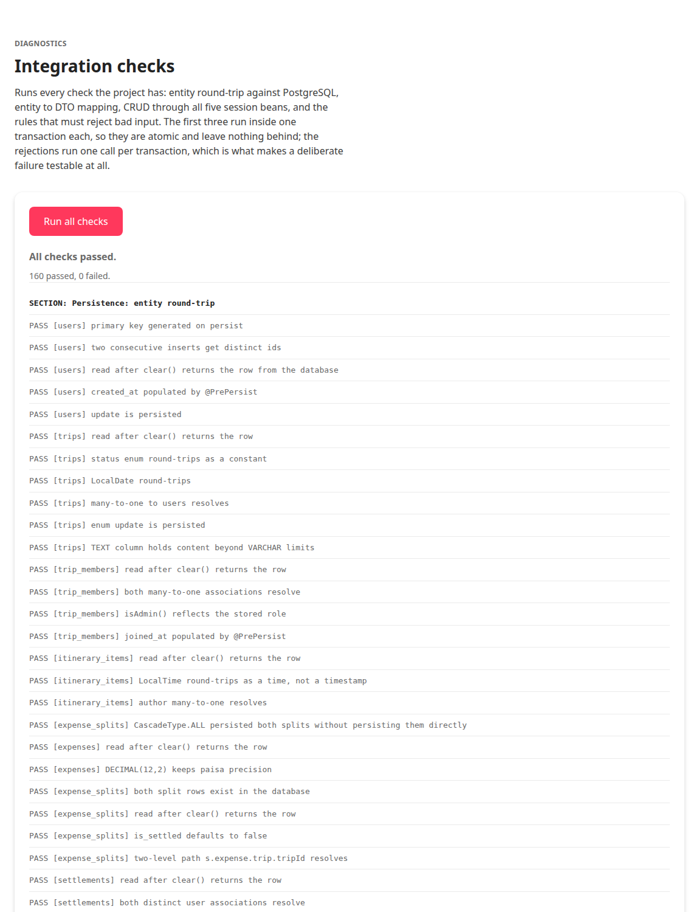

# Phase 4: Session Beans

**Status:** complete, milestone met
**Date:** 2026-09-27
**Milestone (ROADMAP §14):** *EJB methods callable and returning data.*

---

## 1. Deliverables

| Interface | Implementation | Tables owned |
| --- | --- | --- |
| `UserServiceRemote` | `UserService` | `users` |
| `TripServiceRemote` | `TripService` | `trips`, `trip_members` |
| `ItineraryServiceRemote` | `ItineraryService` | `itinerary_items` |
| `ExpenseServiceRemote` | `ExpenseService` | `expenses`, `expense_splits`, `settlements` |
| `ReportServiceRemote` | `ReportService` | read-only, no table of its own |

All five are `@Stateless`, all five have a `@Remote` interface, and together they
cover create, read, update and delete for all seven tables. That satisfies the
assignment's "CRUD operations for all 7 tables" requirement.

Supporting classes:

| Class | Purpose |
| --- | --- |
| `com.tripmate.security.PasswordHasher` | PBKDF2-HMAC-SHA256 hashing and verification |

`com.tripmate.security` is a package the ROADMAP's structure does not list.
Keeping password handling out of `com.tripmate.ejb` means it is obvious that
this class has no container dependencies and can be unit tested on its own.

## 2. Design decisions

### 2.1 Container-managed transactions, and the one place it really matters

No session bean begins or commits a transaction. Every method runs inside one
the container starts and commits, which is what makes the default `REQUIRED`
attribute useful: a call from one bean into another joins the caller's
transaction instead of starting a second one.

`TripService.createTrip` is where that earns its keep. It writes a `trips` row
and a `trip_members` row with role `ADMIN` in the same transaction. A trip
without an administrator is therefore impossible, not merely unlikely, and the
caller cannot get the order wrong because there is only one call to make.

### 2.2 Password handling

Registration hashes with PBKDF2-HMAC-SHA256 at 210,000 iterations, which ships
with the JDK, so this needs no third-party dependency. Three details are worth
recording:

- **The stored format is already in the seed data**, so the seeded users log in
  without a migration. It was verified directly before the beans were written,
  by running the hasher against the hash from `database/seed.sql`:
  correct password verifies, wrong password does not, malformed input returns
  false rather than throwing.
- **Verification compares with `MessageDigest.isEqual`**, which does not stop at
  the first differing byte. A loop using `equals` would leak how much of a hash
  was guessed correctly through its running time.
- **Login spends equivalent work when the email is unknown.** Without that, a
  missing account returns in microseconds while a wrong password takes roughly a
  fifth of a second, and the difference tells an attacker which addresses are
  registered. `login` also returns `null` for both failures rather than
  distinguishing them, for the same reason.

### 2.3 Where the five required queries live

| Query | Method | Bean |
| --- | --- | --- |
| Q1 itinerary ordered by day and time | `getItineraryForTrip` | `ItineraryService` |
| Q2 expenses newest first | `getExpensesForTrip` | `ExpenseService` |
| Q3 trips a user belongs to | `getTripsForUser` | `TripService` |
| Q4 net balance per member | `getMemberBalances` | `ReportService` |
| Q5 category spending per user | `getCategorySpendingForUser` | `ReportService` |

Q1 to Q3 are the natural implementation of operations those services already
had to expose, so they landed with the beans rather than being written twice.
Q4 and Q5 are `ReportService`'s entire reason to exist, and a read-only bean
with only trivial aggregates on it would have been an empty shell.

This means **Phase 5 becomes the dedicated verification** of all five against
expected values, rather than the phase where they are written. The milestone,
"all 5 queries return correct, verified results", is unchanged.

### 2.4 Two business rules landed early

ROADMAP §14 puts the §8.3 rules in Phase 9. Two are enforced already:

- An expense amount must be greater than zero.
- The splits of an expense must sum to its amount.

The second is the central invariant of the data model. Phase 5 verifies the
balance queries against the seeded data, and if the write path could produce an
expense whose splits do not add up, that verification would rest on data the
application is free to corrupt. A rule a later phase depends on belongs in the
earlier phase.

What remains for Phase 9 is everything that needs the **caller's identity**,
which these signatures do not carry: that only an admin may remove a member,
that a trip must keep at least one administrator, and that a user may only add
expenses to trips they belong to. The deferral is recorded in the code, on the
methods concerned, rather than only here.

### 2.5 Two DTO fields added

Both are recorded in the DTOs' own Javadoc, so a reader comparing them against
ROADMAP §7 finds the reason rather than an apparent discrepancy.

- **`TripDTO.description`.** The column exists, the seed populates it, and the
  trip detail page has to display it. Without the field it would have been
  writable only by hand in SQL.
- **`ExpenseDTO.paidById`.** A name cannot identify a payer for a write: two
  users may share one and a name is not a key. The ROADMAP already pairs an id
  with a name in `TripMemberDTO` and in `SettlementDTO`, so this makes
  `ExpenseDTO` consistent with the pattern used everywhere else.

### 2.6 Avoiding the N+1 pattern in list mappings

`TripDTO` has two mapping overloads, and the difference is deliberate. The
convenience one reads `trip.getMembers().size()`, which loads an entire member
collection to count it. `TripService.toDtos` instead fetches the trips with the
administrator join-fetched and then gets every member count in **one grouped
query**, so listing twenty trips costs two queries rather than twenty-one.

`getExpensesForTrip` fetch-joins its splits the same way. Both use `DISTINCT`,
because a fetch join against a collection produces one row per element: without
it, an expense with four splits comes back four times. That trap already caused
a real failure in Phase 3 and is commented at both call sites.

## 3. Verification



One page now runs every check the project has:

```
SECTION: Persistence: entity round-trip   SUMMARY: all 35 checks passed
SECTION: DTO mapping                      SUMMARY: all 55 checks passed
SECTION: Session bean CRUD                SUMMARY: all 60 checks passed
SECTION: Session bean rejections          SUMMARY: all 10 rejections behaved as required

160 passed, 0 failed.
```

The 60 session bean checks drive all five beans through their **remote
interfaces**, which is the milestone: a bean that deploys but whose remote
interface cannot be resolved fails here rather than three phases later inside a
JSF page. They cover register, login with the right and wrong password, profile
update, password change, delete; trip create with its admin membership, read,
update, membership add and remove, delete; itinerary add, ordered read, update,
delete; expense write with splits, both queries, settlement recording, delete;
and the balance and category queries.

Row counts before and after a run are identical, and no `smoke-%` or `sb-%` rows
exist anywhere.

### 3.1 Why the rejections run from the web tier

This is the subtlest thing in the phase, and it shaped the design.

Every one of the three suites runs inside a single bean transaction, which is
what makes it atomic: if anything throws, the whole run rolls back and there is
no cleanup to get wrong.

That also makes those suites the **wrong place to test a deliberate failure**.
An exception escaping a session bean is a *system* exception to the container,
so it marks the transaction rollback-only. Catching it and carrying on would
mean every later statement in that transaction failing for a reason unrelated to
what was being tested.

`DiagnosticsBean` has no transaction of its own, so each call it makes runs in
its own. A rejection rolls back that one call and nothing else. That is both
correct and what makes the cases testable at all.

### 3.2 The checks were proved non-vacuous

The split reconciliation rule was removed from `ExpenseService` and the suite
re-run:

```
SUMMARY: all 35 checks passed
SUMMARY: all 55 checks passed
SUMMARY: all 60 checks passed
SUMMARY: 1 of 10 rejections FAILED
FAIL  [ExpenseService] an expense whose splits do not sum to its amount is rejected (it was accepted)
```

Exactly one check failed, and it was the right one. The other three suites still
passed, which also demonstrates the per-suite isolation: one failing suite does
not hide the other three.

**That run also left residue**, and the reason is worth recording. With the rule
gone, the expense the rejection test submits was actually written: 4,800.00 with
splits totalling 4,000.00, sitting on the seeded Pokhara trip. Five checks then
failed on the *next* run, because the DTO suite asserts all 25 seeded expenses
are balanced and the balance queries assert the net positions sum to zero.

The harness assumes a rejection writes nothing. That assumption held, which is
why a clean run leaves the sample data untouched, and breaking the rule is what
exposed it. The residue was deleted and `database/verify.sql` confirmed the data
was sound again.

## 4. Scaffolding: what was removed and what was kept

Phase 2 and Phase 3 both recorded that their smoke tests would be deleted in
Phase 4. **That changed**, for a reason worth stating.

Removed, because they were placeholders replaced by real code:

- `HelloService`, `HelloServiceRemote`, `HelloBean` (Phase 0)
- `PersistenceCheckBean`, `DtoCheckBean`, `phase2-check.xhtml`,
  `phase3-check.xhtml`, replaced by one `diagnostics.xhtml`

Kept:

- `PersistenceSmokeTest` and `DtoMappingSmokeTest`, plus the new
  `SessionBeanSmokeTest`

They are the project's integration test layer, which ROADMAP §16.1 lists as a
test layer in its own right and suggests implementing as a "manual test servlet".
Deleting them in Phase 4 would have left Phases 5 to 9 with no regression net at
all, which is a bad trade for the tidiness of removing a few classes.

## 5. Reproducing

```bash
./scripts/deploy.sh
xdg-open http://localhost:8080/tripmate/diagnostics.xhtml
```

## 6. Notes for later phases

- **`submitExpenseAsync` writes synchronously.** The name is not yet accurate;
  Phase 7 replaces the body with a JMS send and the message-driven bean calls
  `persistExpense`. The change is recorded on the method itself rather than left
  to be discovered.
- **`removeMember` does not check who is calling.** The admin-only rule and the
  keep-one-admin rule both need the caller's identity, which the ROADMAP
  signature does not carry. Phase 9 has to either add an argument or establish
  the caller some other way.
- **Q4 is the gross position.** It counts every split regardless of
  `is_settled` and does not net off recorded settlements. The Settle Up flow in
  Phase 8 asks the different question of what has already been repaid, and
  conflating the two is the most likely source of a wrong balance.
- **The rejection cases depend on the rules running before any write.** If a
  rule is ever moved to after the persist, the harness will start leaving
  residue instead of failing cleanly, exactly as the sabotage in §3.2 did.
- **`DiagnosticsBean` is temporary.** Phase 6 builds the real login and trip
  pages; the diagnostics page can stay as a development tool or move under a
  URL only reachable in development, but it should not be part of the product
  surface.

---

## 7. Next: Phase 5, the five queries verified

Each of the five queries tested in isolation against the seeded data, with
expected values computed independently from SQL rather than from the query under
test.

**Milestone:** all 5 queries return correct, verified results.
