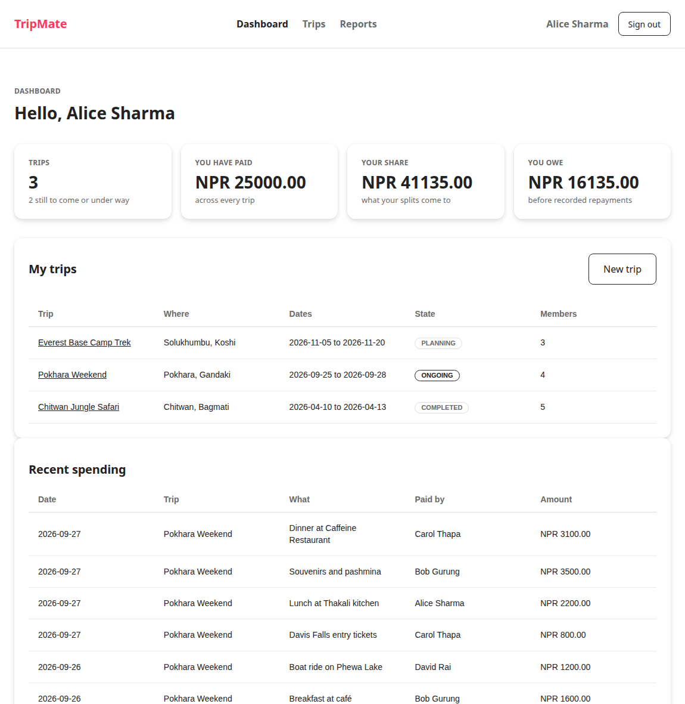
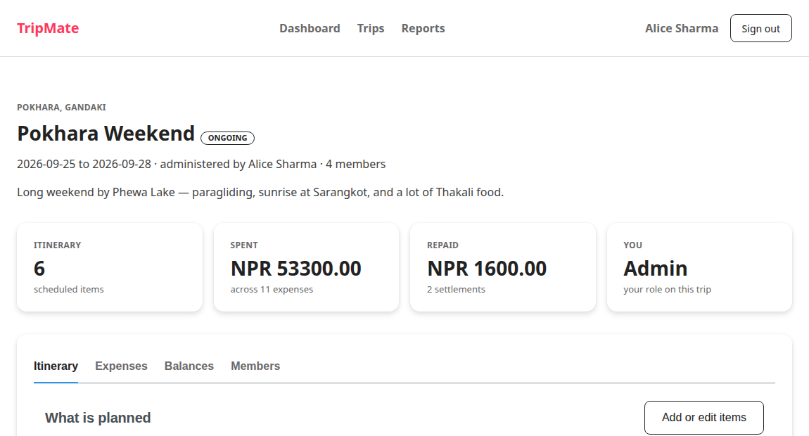
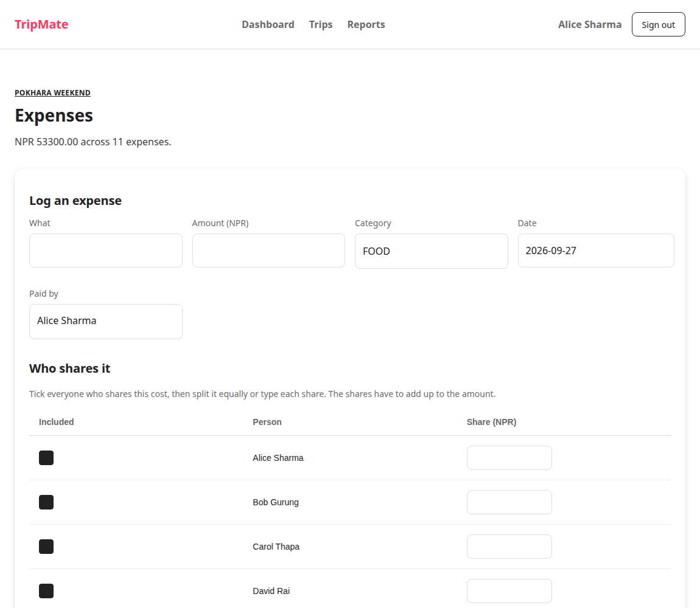
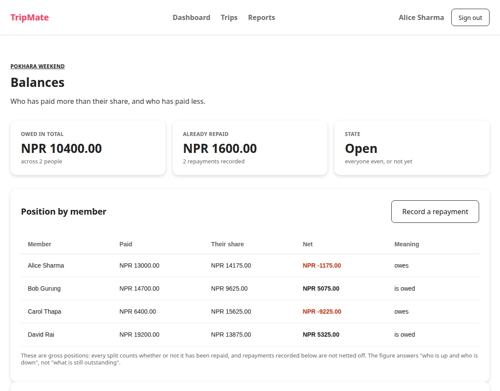
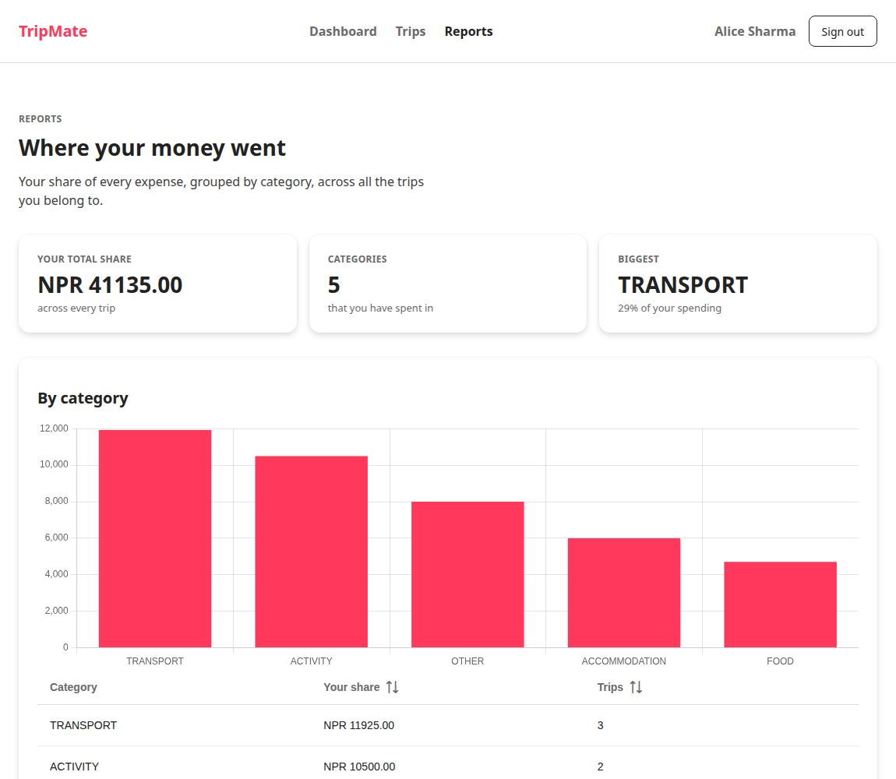

# Phase 6: The Web Tier

**Status:** complete, milestone met
**Date:** 2026-09-27
**Milestone (ROADMAP §14):** *Full CRUD usable from the browser.*

---

## 1. Deliverables

All twelve pages from ROADMAP §11.2, plus the pieces they need:

| # | Page | What it does |
| --- | --- | --- |
| 1 | `login.xhtml` | Sign in |
| 2 | `register.xhtml` | Create an account |
| 3 | `dashboard.xhtml` | Totals, the user's trips, recent spending |
| 4 | `trips/list.xhtml` | Every trip the user belongs to |
| 5 | `trips/create.xhtml` | Create a trip, becoming its administrator |
| 6 | `trips/detail.xhtml` | Four tabs: itinerary, expenses, balances, members, plus trip edit and delete |
| 7 | `trips/itinerary.xhtml` | Add, edit, copy and delete itinerary items |
| 8 | `trips/expenses.xhtml` | Log an expense with a split editor |
| 9 | `trips/balances.xhtml` | Query 4, plus what would settle the trip |
| 10 | `trips/settle.xhtml` | Record a repayment |
| 11 | `reports/index.xhtml` | Query 5 as a chart and a table |
| 12 | `profile.xhtml` | Details and password |

Supporting pieces:

| Class | Purpose |
| --- | --- |
| `WEB-INF/templates/layout.xhtml` | The shell: top nav, `p:messages`, footer |
| `CurrentUser` | Session-scoped signed-in user |
| `AuthenticationFilter` | Redirects anyone not signed in |
| `LocalTimeConverter` | Faces 4.0 has no converter for `java.time` |
| `DiagnosticsBean` | Still runs the Phases 2 to 5 suites |

## 2. Fitting PrimeFaces to DESIGN.md

PrimeFaces supplies behaviour and structure; DESIGN.md supplies the appearance.
The `saga` theme is fully parameterised, so most of the mapping is done by
pointing its own custom properties at the design tokens rather than by fighting
its rules.

**Two things had to be discovered rather than read.**

**The default artifact is javax, not jakarta.** `org.primefaces:primefaces`
deploys and then fails with `NoClassDefFoundError: javax/servlet/ServletRequestListener`.
The `jakarta` classifier is a separate download and nothing in the coordinates
says so. PrimeFaces 14 is used rather than 15 because 15 wants Faces 4.1, which
GlassFish 7 does not ship.

**The theme beats a plain class selector regardless of load order.** Its rules
are written `body .ui-button`, giving them a specificity of one element plus one
class. A bare `.ui-button` loses to that even when it appears later in the
document. Every override is therefore prefixed with `body ` to match, and the
comment above them says not to remove it. Related: overriding the theme's
`--primary-color` variable alone does nothing, because the button rule hardcodes
the blue literal and never reads the variable.

Where the theme offers a colour the system does not have, the override is
deliberate rather than cosmetic: buttons, tabs, checkboxes, table headers and
focus rings all took the theme's blue and now take ink or Rausch.

The design system's restraint is kept. Rausch appears on primary actions and
almost nowhere else. The active nav item and the active tab are marked in ink
with an ink rule, which is one convention in two places. CANCELLED is the only
status pill that carries colour. Success notices are ink on the soft surface
rather than a green, because DESIGN.md defines no success colour and adding one
would put a second accent into a palette built around a single one.

## 3. Bugs found by running it

Six, all of which produced a symptom that did not point at the cause.

### 3.1 A conversion failure silently skipped the action

The most instructive one. Adding an itinerary item did nothing: the page
redisplayed, nothing was logged, and the submitted values *had* been applied to
the form.

The chain: Faces 4.0 has **no converter for `java.time` types** (those arrive
with Faces 5 in Jakarta EE 11). A `selectOneMenu` holding `LocalTime` therefore
failed conversion. A conversion failure raises a validation error, and JSF then
**skips the invoke-application phase entirely**, so the action method never ran.
And because nothing rendered Faces messages, the error had nowhere to appear.

Two fixes: a `LocalTimeConverter`, and `p:messages` in the layout. Without the
second, the next such failure would have been just as invisible.

### 3.2 A relative navigation outcome resolves against the current directory

`outcome="trips/create"` works from `/dashboard.xhtml` but from
`/trips/list.xhtml` it looks for `/trips/trips/create.xhtml` and fails at render
with "could not resolve NavigationCase". Every outcome is now an absolute view
id. This is why the fault looked intermittent: it depended on which page the
link was on.

### 3.3 XML comments may not contain a double hyphen

Dash rules used as separators inside `<!-- -->` made two pages fail to parse
entirely. Now equals signs, with a check across the webapp.

### 3.4 `p:chart` in PrimeFaces 14 has no `model` attribute

The tag takes a raw JSON `value`. An unknown attribute is ignored rather than
reported, so passing the XDev `BarChartModel` produced an empty canvas with
nothing in the log. The configuration is now built with JSON-P, which ships with
Jakarta EE. The taglib was the source of truth here; the component's own
description still mentions the model, which is what made this worth checking
rather than assuming.

### 3.5 UICommand components need a UIForm ancestor

The row buttons in two tables sat outside any form, so the development stage
painted a warning banner across the page. Both tables now have their own form.

### 3.6 EL 5 does not expose record accessors as properties

`#{expense.date}` fails on a record, because the accessor is `date()` and EL
resolves bean properties by the JavaBean convention. Record support arrives with
EL 6 in Jakarta EE 11. Three view models are therefore small classes with
getters.

## 4. Verification

Every page in the inventory was requested with a signed-in session:

```
1 login            200    7 itinerary        200
2 register         200    8 expenses         200
3 dashboard        200    9 balances         200
4 trips list       200   10 settle           200
5 trip create      200   11 reports          200
6 trip detail      200   12 profile          200
                          -- diagnostics     200
```

All with zero Faces warnings and zero parse errors. Requested anonymously, every
protected page returns 302 to the sign-in page.

### 4.1 The ROADMAP's demo scenario, run for real

The §16.3 walkthrough was executed against the seeded data, including the two
steps it performs live:

- **"Dinner at Lakeside", NPR 4,800 split four ways.** The equal-split action
  computed 1,200.00 each, and saving wrote the expense with four splits
  totalling exactly 4,800.00.
- **Bob paying Alice NPR 1,200.** Recorded as a settlement, which is deliberately
  absent from the seed so the demo can make it.

The test data was then removed and the sample data confirmed back at baseline:
5 users, 3 trips, 12 memberships, 15 itinerary items, 25 expenses, 100 splits,
6 settlements.

### 4.2 Page by page

| Page | Checked |
| --- | --- |
| Dashboard | 3 trips, NPR 25,000 paid, NPR 41,135 share, NPR 16,135 owed |
| Trip detail | 6 itinerary items in schedule order, NPR 53,300 across 11 expenses, NPR 1,600 repaid |
| Itinerary | add, edit, copy and delete each round-trip to the database; an item lands in schedule order between the seeded items either side of it |
| Expenses | 1,000.00 split three ways gives 333.34, 333.33, 333.33, totalling exactly 1,000.00; an unbalanced split is refused with a message and nothing is written |
| Balances | Alice -1,175, Bob +5,075, Carol -9,225, David +5,325, matching the Phase 5 query-4 figures exactly |
| Settle | recording writes it; paying yourself is refused |
| Reports | NPR 41,135 across 5 categories, matching the Phase 5 query-5 SQL exactly, with TRANSPORT largest at 29 per cent |
| Profile | saving details persists; a wrong current password is refused without altering the stored hash |

### 4.3 The suggestion on the balances page

Given those balances, matching the largest debtor against the largest creditor
produces Carol to David 5,325, Carol to Bob 3,900, and Alice to Bob 1,175, which
totals the 10,400 owed. The greedy pass does not always give the theoretical
minimum number of payments, but it never asks anyone to pay more than they owe,
which is the property that matters. It is labelled as a suggestion and nothing
is written until someone records it.

## 5. Screenshots

| | |
| --- | --- |
|  |  |
|  |  |
|  | |

## 6. Reproducing

```bash
./scripts/deploy.sh
xdg-open http://localhost:8080/tripmate/
```

Sign in as `alice@tripmate.test` with `tripmate123`.

## 7. Notes for later phases

- **The stub pages are gone.** As each page was built its stub was replaced, so
  there is nothing left over.
- **`CurrentUser` is the only session state.** Everything else is request or
  view scoped. That matters for Phase 7: the async expense submission must not
  assume anything about the session in the message-driven bean.
- **The balances page shows the gross position.** It says so on the page, in
  plain words, because that is the figure most likely to be misread as what is
  still outstanding.
- **`phase6` scaffolding is not scaffolding.** Unlike the earlier phases, these
  pages are the product. The diagnostics page remains as a development tool and
  should not be part of any demonstration to a marker unless the test story is
  being shown.
- **The screenshots in `docs/screenshots/` were captured by rendering the
  authenticated page markup**, because Chrome's command line cannot carry a
  session. They show real data.

---

## 8. Next: Phase 7, messaging

Configure the JMS queue on GlassFish, add `ExpenseMessage` and
`ExpenseMessageBean`, change `submitExpenseAsync` to send a message, and point
the expense form at it.

**Milestone:** an expense saved through the message-driven bean, verified in the
log and the database.
