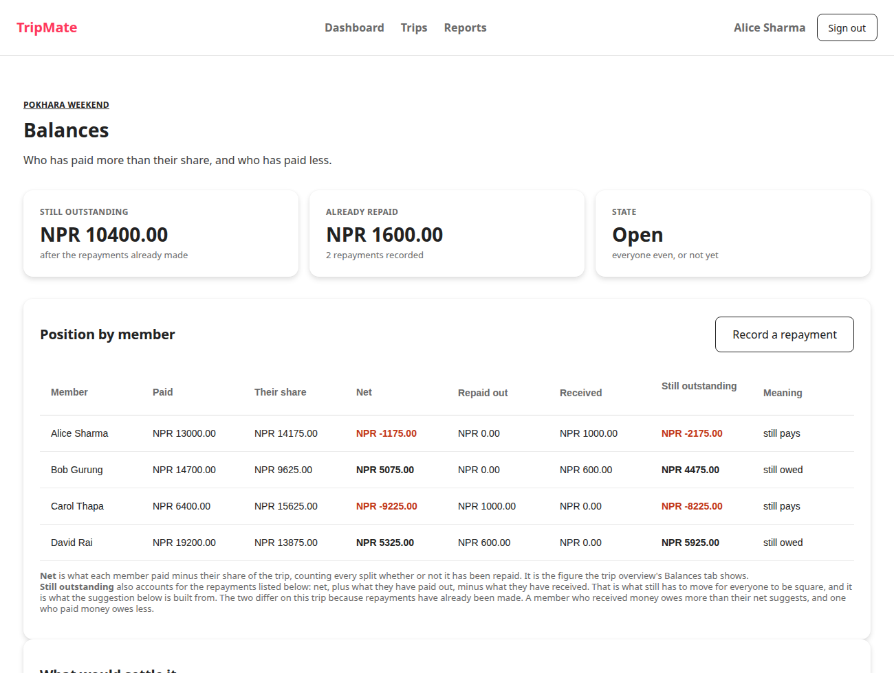

# Phase 8: Complex UI Features

**Status:** complete, milestone met
**Date:** 2026-09-27
**Milestone (ROADMAP §14):** *Both complex queries visible in the UI.*

---

## 1. What this phase was

The three features Phase 8 names were built with the Phase 6 pages, because they
are parts of pages rather than pages of their own. This phase is therefore the
milestone check, plus one correctness fix the milestone check turned up.

## 2. The milestone

**Query 4, on `trips/balances.xhtml`:**

```
Position by member

Alice Sharma   13000.00  14175.00  -1175.00    0.00  1000.00  -2175.00  still pays
Bob Gurung     14700.00   9625.00   5075.00    0.00   600.00   4475.00  still owed
Carol Thapa     6400.00  15625.00  -9225.00 1000.00     0.00  -8225.00  still pays
David Rai      19200.00  13875.00   5325.00  600.00     0.00   5925.00  still owed
```

**Query 5, on `reports/index.xhtml`:**

```
Your total share  NPR 41135.00     Categories  5     Biggest  TRANSPORT (29%)

"labels":["TRANSPORT","ACTIVITY","OTHER","ACCOMMODATION","FOOD"]
```

Both figures match the Phase 5 verification exactly, which is the point: the
queries were verified against raw SQL, and the UI shows what the queries return.

## 3. The settle-up flow was asking for the wrong amounts

Building the milestone check meant reading the balances page against the
settlements table, and the two did not agree.

The page showed query 4's figures, which are **gross**: what each member paid
against what their splits come to, counting every split whether or not it has
been repaid. It then suggested payments from those same figures. But the seeded
Pokhara trip has two repayments already recorded, so the page told **Carol she
owed 9,225 when she had already paid Alice 1,000 of it**, and suggested she pay
the whole 9,225.

It was internally consistent, which is why it survived Phase 6: the numbers on
screen did add up, to the wrong question. The question someone asks before
paying somebody is what is *still* outstanding.

### The fix

The page now computes both and labels them:

```
net         = paid - share                        (the gross position, from query 4)
outstanding = net + repaid out - received         (what still has to move)
```

and builds the suggestion from `outstanding`. On the same trip:

| | Before | After |
| --- | --- | --- |
| Carol is asked to pay | 9,225.00 | **8,225.00** |
| David is owed | 5,325.00 | **5,925.00** |
| Suggestion | Carol to David 5325, Carol to Bob 3900, Alice to Bob 1175 | Carol to David 5925, Carol to Bob 2300, Alice to Bob 2175 |

David is owed *more* than his net suggests, because he paid out 600 that was not
his share. That is the kind of thing the gross figure hides, and it is why both
are now on the page with a sentence explaining the difference.

The ledger sums to exactly **0.00** across all three trips.

## 4. The arithmetic is asserted, not trusted

This is the only place in the application where a figure the user acts on is
computed in the web tier rather than by the database, so it is worth testing.
A sixth suite was added to the diagnostics page, asserting **properties** rather
than expected values, so it holds whatever the data:

- Outstanding positions sum to exactly zero.
- A member who has neither paid nor received a repayment has an outstanding
  figure equal to their net.
- The suggestions total exactly what is owed to creditors.
- **Nobody is asked to pay more than they still owe.** This is the property the
  original bug broke.
- A settled trip needs no payments.

```
Balances and settle-up arithmetic    all 15 arithmetic checks passed
```

### It was proved non-vacuous, on the second attempt

The first sabotage changed only the *classification* of who is a debtor, leaving
the amounts coming from the outstanding figures. All 15 checks still passed, and
rightly so: the same four people are debtors and creditors either way, so the
output was genuinely identical. **The sabotage was ineffective, not the test.**

The second attempt changed the *amounts*, which is what actually differed before
the fix:

```
SUMMARY: 3 of 15 arithmetic checks FAILED
FAIL  [Settle-up] trip 1: nobody is asked to pay more than they owe
FAIL  [Settle-up] trip 3: suggestions total what is owed to creditors
FAIL  [Settle-up] trip 3: nobody is asked to pay more than they owe
```

Worth recording because the first result looked like a passing test and was
actually a badly aimed experiment. Distinguishing "the check is weak" from "my
sabotage did not change the behaviour" is the same skill as distinguishing a
real failure from a stale view state, which cost time twice in Phase 6.

## 5. A display fix

Money rendered as `NPR 0` beside `NPR 1200.00`, because `BigDecimal.ZERO` has a
scale of zero. Every amount in the ledger is now normalised to two decimal
places, so a column of money reads as money.

## 6. Verification

```
Persistence: entity round-trip        all 35 checks passed
DTO mapping                           all 55 checks passed
Session bean CRUD                     all 60 checks passed
The five required queries             all 97 query checks passed
Session bean rejections               all 10 rejections behaved as required
Balances and settle-up arithmetic     all 15 arithmetic checks passed

272 passed, 0 failed.
```

Sample data at baseline, `database/verify.sql` passing.



## 7. Reproducing

```bash
./scripts/deploy.sh
xdg-open http://localhost:8080/tripmate/trips/balances.xhtml?tripId=1
```

## 8. Notes for later phases

- **`MemberPosition` and the two static methods on `BalancesBean` are package
  private so the diagnostics can reach them.** They are the only web-tier
  arithmetic the suite covers. If more moves there, it should come with checks
  in the same shape.
- **Phase 9 must throw `ValidationException`, not `IllegalArgumentException`.**
  Restated from the Phase 7 notes because it now applies to more code: the
  authorization rules will be reached by the message consumer, and a bare
  runtime exception there marks the transaction rollback-only and reintroduces
  the redelivery loop.
- **The test matrix in §16.2 is Phase 10's**, not this phase's. Two of its
  entries, "non-member tries to add expense" and "remove member as non-admin",
  are Phase 9 rules and are currently **not** enforced; they will fail until
  those rules exist.

---

## 9. Next: Phase 9, business rules and validation

Implement the §8.3 rules in the EJB layer: the two authorization rules (only an
admin may remove a member, and a trip must keep at least one), and that a user
may only add expenses to trips they belong to. Plus the JSF validation layer.

**Milestone:** invalid operations rejected at the business tier.
