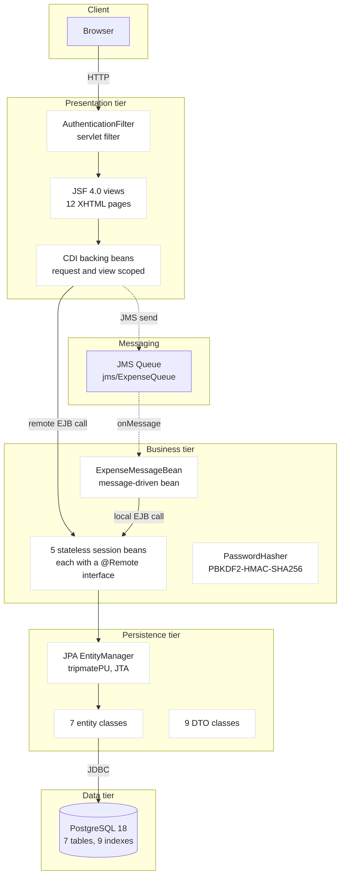
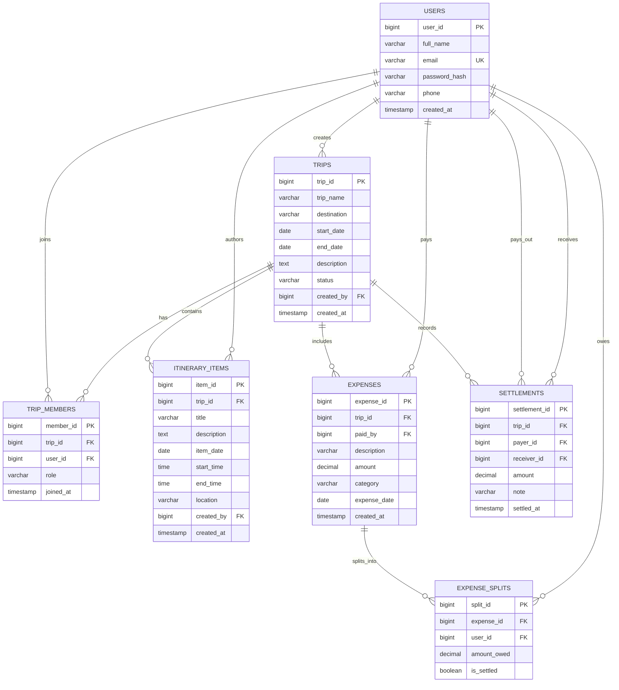
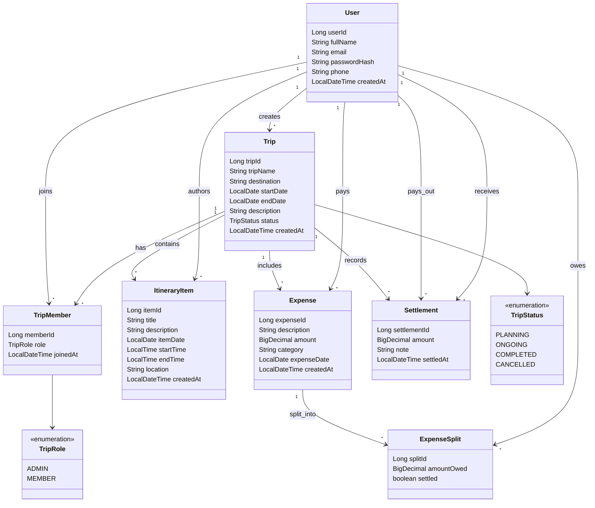
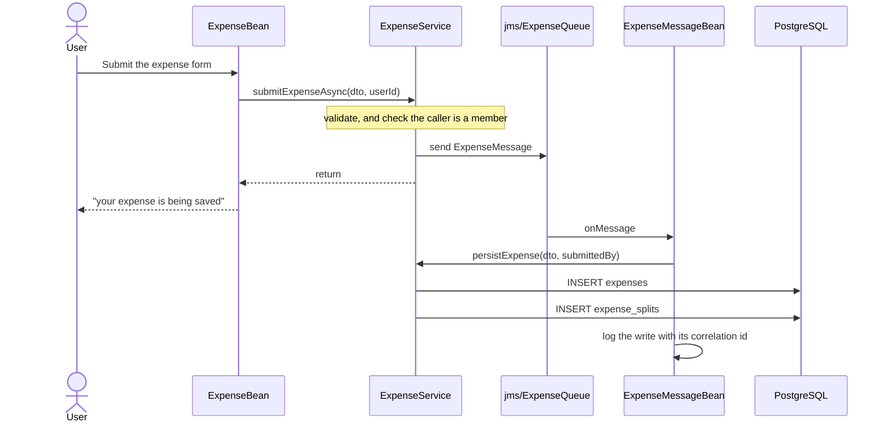
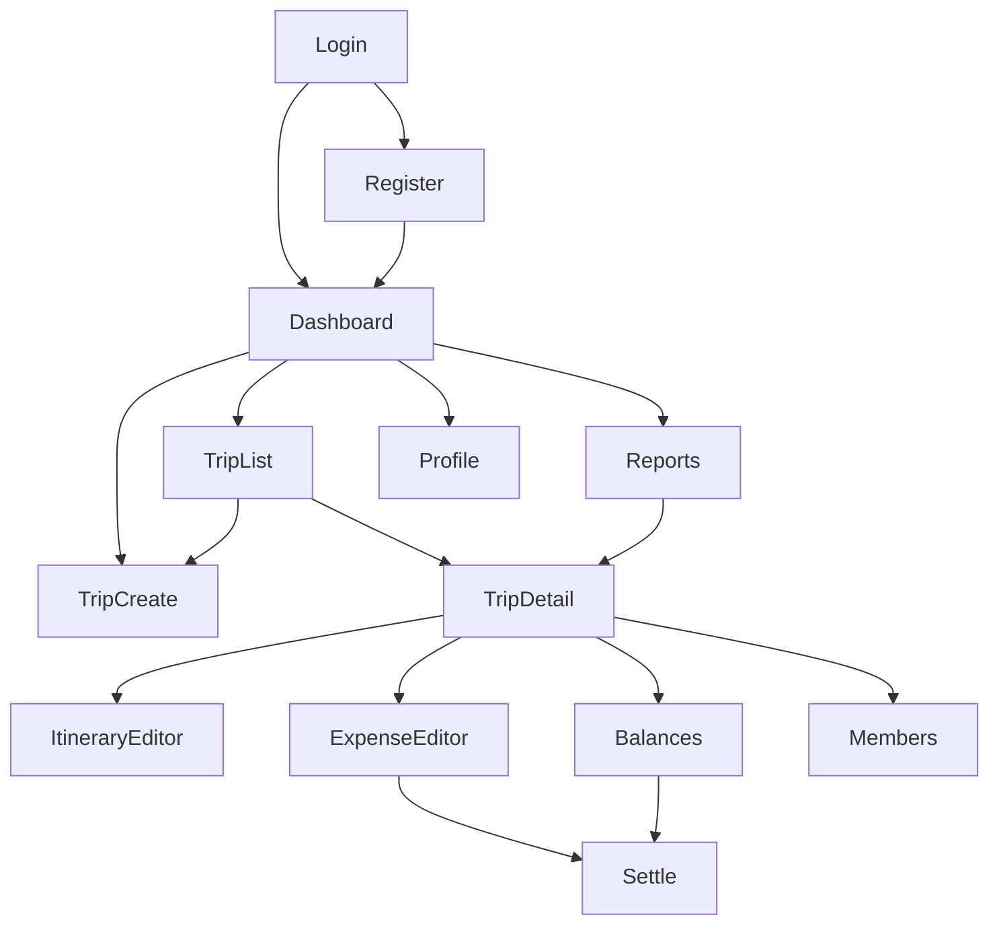

# TripMate: Design, Documentation and Implementation

**Group Trip Planning and Expense Tracking System**

A distributed enterprise web application built on Jakarta EE 10

---

| | |
| --- | --- |
| **Project** | TripMate |
| **Module** | CT066-3-M-EA, Designing Serverless Architectures and Enterprise Applications |
| **Architecture** | N-tier Jakarta EE |
| **Runtime** | Eclipse GlassFish 7.0.18, Jakarta EE 10 full profile |
| **Persistence** | PostgreSQL 18 with JPA 3.1 and JPQL |
| **Messaging** | Jakarta Messaging 3.1 with a message-driven bean |
| **Build** | Maven multi-module, JDK 17 |
| **Author** | Srijan Karki |
| **Date** | 27 September 2026 |

---

## Table of contents

1. [System proposal](#1-system-proposal)
2. [Architecture](#2-architecture)
3. [Database design](#3-database-design)
4. [Persistence tier](#4-persistence-tier)
5. [Business tier](#5-business-tier)
6. [Messaging](#6-messaging)
7. [Web tier](#7-web-tier)
8. [The five required queries](#8-the-five-required-queries)
9. [Business rules](#9-business-rules)
10. [Testing and verification](#10-testing-and-verification)
11. [Project plan](#11-project-plan)
12. [Deviations from the plan](#12-deviations-from-the-plan)
13. [Limitations and future work](#13-limitations-and-future-work)
14. [References](#14-references)

> **On page numbers.** This document is Markdown, so it has no fixed pagination.
> The numbered headings above map to numbered sections in any export, and the
> section numbers are stable. A PDF or Word export with an automatically
> generated table of contents will produce page numbers.

---

## 1. System proposal

### 1.1 The problem

Groups of friends, families and colleagues travel together, and the same
coordination failures recur on every trip.

Nobody remembers who paid for what. Splitting costs fairly turns into an
argument, and settling up afterwards is awkward because nobody is certain of the
figures. The itinerary lives scattered across chat threads, notes apps and email.
There is no single place where the plan and the financial state of the trip are
visible together.

The tools that exist solve one half each. Messaging apps handle conversation but
not money. Spreadsheets handle money but not the plan, and they are unpleasant to
use on a phone. Notes apps handle the plan but have no concept of the group.
Nothing ties the three together for a small, trusted group of travellers.

### 1.2 The solution

TripMate is a web application in which a group can:

- Create a trip and invite members.
- Build a shared day-by-day itinerary.
- Log expenses as they happen, split among any subset of the group.
- See at any point who has paid more than their share and who has paid less.
- Record repayments when money actually changes hands.
- See spending summarised by category across all their trips.

### 1.3 Why this is an enterprise application

The problem is small, but its domain exercises the machinery the assignment
asks for, and each technology is present because the domain needs it rather than
to satisfy a checklist.

| Requirement | Where it comes from in the domain |
| --- | --- |
| Many linked tables | Trips, memberships, itinerary, expenses, per-person splits and repayments are genuinely distinct entities with real relationships |
| Remote interfaces and DTOs | The web tier must not see JPA entities; the boundary is where DTOs live |
| Transactional business rules | A trip and its administrator, and an expense and its splits, must be written together or not at all |
| Complex queries | Balances and category spending are aggregations over four entities that only the database should compute |
| Asynchronous messaging | Creating an expense writes several rows, and the browser should not wait for them |
| A web client | The users are travellers on phones, not operators at a terminal |

### 1.4 Target users

| Role | Description | What they can do |
| --- | --- | --- |
| **Registered user** | Any traveller with an account | Create trips, join trips they are invited to, log expenses, view balances |
| **Trip administrator** | The member who created a trip | Everything a member can, plus invite and remove members, and edit or delete the trip |
| **Trip member** | Anyone invited to a trip | View the itinerary, add and edit itinerary items, log expenses, view balances, record repayments |

**Role is per trip, not global.** The same person can administer one trip and be
an ordinary member of another, which is why the role lives on the membership row
rather than on the user.

### 1.5 Commercial framing

As a product, TripMate is a SaaS platform for small travel groups: free for up
to three trips, with paid tiers for larger groups, richer analytics and
integrations. The evaluation of that commercial framing against a serverless
deployment, and the point at which serverless becomes the cheaper option, is the
subject of Part One (`docs/serverless-report.md`).

---

## 2. Architecture

### 2.1 N-tier structure



### 2.2 Inter-tier contracts

| From | To | Contract |
| --- | --- | --- |
| Browser | Presentation | HTTP over the servlet container |
| Servlet filter | JSF views | Session check, redirect when absent |
| JSF view | Backing bean | EL method and property binding |
| Backing bean | Business tier | Remote EJB call across the EAR boundary, `@Remote` interfaces |
| Backing bean | Messaging | JMS send through an injected `JMSContext` |
| Queue | Message-driven bean | Container-managed delivery and transaction |
| Message-driven bean | Business tier | Local EJB call |
| Business tier | Persistence tier | Container-managed `EntityManager`, JTA transactions |
| Persistence tier | Data tier | JDBC through a pooled `DataSource` |

### 2.3 Why this shape

**The tiers are separated by what changes for different reasons.** Presentation
changes when the interface changes. Business rules change when the domain
changes. Mapping changes when the schema changes. Coupling those would mean a
change to a button label carrying a risk to a financial calculation.

**The business tier is the only place rules live.** A rule enforced in the web
tier protects one client; a rule in the business tier protects the data. Every
rule with a database constraint behind it also has a check in a session bean, so
the caller gets a readable message and the data is protected if the caller
somehow is not.

**The application is one EAR, not separate deployments.** The web module and the
EJB module are packaged together, so the remote interfaces are local calls at
runtime while remaining `@Remote`, which is what the assignment requires. This
keeps deployment a single operation without weakening the boundary in the code.

---

## 3. Database design: tables and ERD

### 3.1 The seven tables

The assignment requires at least three linked tables. TripMate uses seven,
because the domain genuinely has seven distinct things in it and collapsing any
two would create a table that means two things.

| Table | Holds | Rows in the sample data |
| --- | --- | --- |
| `users` | Registered travellers | 5 |
| `trips` | One trip, with its dates and lifecycle state | 3 |
| `trip_members` | Who is on a trip, and in what role | 12 |
| `itinerary_items` | Scheduled activities, one row each | 15 |
| `expenses` | One cost, and who paid it | 25 |
| `expense_splits` | What each participant owes for one expense | 100 |
| `settlements` | A repayment that actually happened | 6 |

### 3.2 Entity relationships



### 3.3 Design decisions worth defending

**`trip_members` is an entity, not a join table.** Membership carries a role and
a join date. Those belong to the relationship, not to either side of it, which
is exactly the case where a many-to-many mapping is the wrong tool.

**Money is `DECIMAL(12,2)`, never floating point.** A balance is a running sum of
many small values. Binary floating point cannot represent `0.10` exactly, so
rounding error accumulates until the splits stop reconciling with the amounts.
`numeric` is exact, and the sample data is asserted to the paisa.

**Dates and times are separate from audit timestamps.** `item_date` and
`start_time` are `DATE` and `TIME`, not `TIMESTAMP`, so query 1 can order by
calendar day without a truncation expression. `created_at` stays a `TIMESTAMP`
because it records an instant rather than a schedule.

**Constraints enforce what a single row can express.** `UNIQUE (trip_id,
user_id)` stops a duplicate membership. `CHECK (amount > 0)` stops a
non-positive expense. `CHECK (payer_id <> receiver_id)` stops a settlement
paying yourself. The one rule that spans rows, that an expense's splits must sum
to its amount, cannot be a constraint and is enforced in the business tier.

**Referential actions are chosen per relationship.** Trip-owned rows cascade
from `trips`, because a membership or an expense has no meaning without its
trip. Nullable user attributions use `ON DELETE SET NULL`, so removing a user
does not erase a trip or a financial record. Identity-defining references, such
as a membership or a split, cascade.

**Indexes follow the queries, not the tables.** Nine indexes, each traceable to
an access path the application actually uses. PostgreSQL already indexes primary
keys and unique constraints, so nothing duplicates those.

---

## 4. Database access design

### 4.1 The seven entities, and how they are mapped

| Entity | Table | Notes |
| --- | --- | --- |
| `User` | `users` | Owns no role; membership carries that |
| `Trip` | `trips` | Root of the domain |
| `TripMember` | `trip_members` | The join entity with payload |
| `ItineraryItem` | `itinerary_items` | Date and two times, kept separate |
| `Expense` | `expenses` | The only entity whose collection cascades |
| `ExpenseSplit` | `expense_splits` | One participant's share |
| `Settlement` | `settlements` | Two independent references to `User` |

Two enums, `TripStatus` and `TripRole`, are persisted as strings so the database
value is readable and matches the `CHECK` constraint. Ordinal storage would
silently re-interpret every existing row if a constant were ever inserted in the
middle of the list.

### 4.2 Mapping decisions

**Every column is mapped explicitly.** EclipseLink has no snake_case naming
strategy and would otherwise look for `USERID` rather than `user_id`. Verbose,
but unambiguous, and it keeps the mapping honest against the schema.

**`allocationSize = 1` on every sequence generator.** The schema's `BIGSERIAL`
columns are backed by sequences that increment by 1, and EclipseLink's default
allocation size is 50. Left at the default the provider would hand out ids 1 to
50 while the sequence advanced once, and the fifty-first insert would collide
with the first. The smoke test asserts two consecutive inserts receive distinct
ids, so the default cannot creep back in.

**Collections are lazy and cascade is scarce.** Loading a trip must not drag in
every expense. Cascade is set in exactly one place, on `Expense.splits`, because
a split has no independent existence. The trip-owned collections carry no JPA
cascade at all, because the schema already cascades and two mechanisms for one
job eventually disagree.

**DDL generation is off.** The schema belongs to `database/schema.sql`. Left at
its default the provider could create or alter tables during deployment,
silently diverging from the schema this report documents and dropping the
constraints and indexes that no generated DDL would reproduce.

### 4.3 UML class diagram

The entity model as classes, with the fields each carries. The two enums are
shown as types rather than as entities: they have no table of their own and are
persisted as strings.



### 4.4 Data transfer objects

Nine DTOs form the boundary between the business tier and its clients. The
assignment asks for eight; `SettlementDTO` is the ninth, because the service
interface requires it while the assignment's DTO table omits it.

| DTO | Purpose |
| --- | --- |
| `UserDTO` | Profile. Deliberately has no password field at all |
| `TripDTO` | Trip summary with administrator name and member count |
| `TripMemberDTO` | A membership, with the role held on that trip |
| `ItineraryItemDTO` | One scheduled activity |
| `ExpenseDTO` | An expense with its splits nested inside it |
| `SplitDTO` | One participant's share |
| `SettlementDTO` | A recorded repayment |
| `MemberBalanceDTO` | Result of complex query 1 |
| `CategorySpendingDTO` | Result of complex query 2 |

**Why DTOs rather than entities across the boundary.** Three reasons, in order
of importance. A DTO carries only the fields the client needs, so a
`password_hash` that is never placed into an object cannot leak. A DTO holds
plain values rather than managed references, so a lazy association cannot be
touched after the persistence context has closed. And the wire contract is
explicit rather than accidental, since a change to an entity's field is not
automatically a change to the protocol.

The absence of a password field is enforced structurally: a diagnostics check
asserts by reflection that no DTO declares any field whose name mentions a
password.

---

## 5. Business tier design

### 5.1 The five session beans

All five are `@Stateless` with a `@Remote` interface. Statelessness is
appropriate because no business operation needs conversational state across
requests, which lets the container pool and reuse instances.

| Bean | Owns | Responsibility |
| --- | --- | --- |
| `UserService` | `users` | Registration, authentication, profile, password |
| `TripService` | `trips`, `trip_members` | Trip CRUD, membership and roles |
| `ItineraryService` | `itinerary_items` | Itinerary CRUD |
| `ExpenseService` | `expenses`, `expense_splits`, `settlements` | Expenses with splits, repayments, the asynchronous submission |
| `ReportService` | none | The two complex queries, read-only |

### 5.2 Container-managed transactions

No session bean begins or commits a transaction. Every method runs inside one
the container starts and commits, which is what makes the default `REQUIRED`
attribute useful: a call from one bean into another joins the caller's
transaction rather than starting a second one.

The clearest example is `TripService.createTrip`. It writes a `trips` row and a
`trip_members` row with role `ADMIN` in the same transaction, so **a trip
without an administrator is impossible rather than merely unlikely**, and the
caller cannot get the order wrong because there is only one call to make. The
same applies to `ExpenseService.persistExpense`, which writes one expense row
and one split row per participant together.

### 5.3 Password handling

Registration hashes with PBKDF2-HMAC-SHA256 at 210,000 iterations, which ships
with the JDK and so adds no dependency. Three details are worth recording.

The stored format is `pbkdf2_sha256$<iterations>$<salt>$<hash>`, and the
parameters travel with the hash. That is what makes the work factor upgradable:
raising the iteration count does not invalidate existing rows, because
verification reads the count each hash was created with.

Verification compares using `MessageDigest.isEqual`, which does not stop at the
first differing byte. A loop using `equals` would leak how much of a hash was
guessed correctly through its running time.

Sign-in spends equivalent work when the email is unknown, and returns the same
failure for an unknown address and a wrong password. Without both, the
difference in response time would tell an attacker which addresses are
registered.

### 5.4 The web tier never sees an entity

Every method on every `@Remote` interface takes and returns DTOs. Entities are
mapped inside the business tier, while the persistence context is still open,
which is also the only place the mapping can safely traverse a lazy association.

---

## 6. Messaging

### 6.1 Why an expense is written asynchronously

Adding an expense writes one `expenses` row and then one `expense_splits` row
per participant. The splits have to be written in the same transaction as the
expense, or the two could disagree and the balance calculation would be wrong.

That is a multi-record write which the browser does not need to wait for.
Sending it as a message:

- Decouples the web tier from the persistence work, so the response returns as
  soon as the message is on the queue.
- Gives a natural extension point. Notifications, analytics or fraud checks can
  subscribe later without the client changing.
- Demonstrates a genuine enterprise-messaging use case rather than a contrived
  one.

### 6.2 The flow



### 6.3 What the consumer adds, and what it does not

The message-driven bean adds nothing to the write path. It calls the same
`persistExpense` method the synchronous path uses. Its only job is to move the
write off the request thread.

**Validation stays on the caller's side.** The asynchronous route applies the
same rules before sending, in the caller's own transaction, so an expense that
could never be stored is refused while the user is still looking at the form,
rather than being put on a queue to be rejected later by a consumer with no way
to tell anyone. Membership is checked again at write time, so an expense
submitted by someone who has since left the trip is refused rather than written.

### 6.4 Failure handling, which was not straightforward

A message that throws is rolled back and redelivered. A message that can never
succeed would then be redelivered forever, and the first version of this
consumer did exactly that, producing thousands of log lines a second.

Two things had to be right, and neither was visible from reading the code.

A runtime exception thrown out of a session bean does not reach the caller as
itself, because the container wraps it. Testing the exception type that arrives
therefore misclassifies every failure.

More fundamentally, a runtime exception out of a session bean is a **system**
exception to the container, which marks the transaction rollback-only. Once that
has happened, returning normally from `onMessage` still ends in a rollback, the
message is never acknowledged, and it is redelivered immediately.

The fix is a `ValidationException` declared `@ApplicationException(rollback =
false)`, thrown for refused input, so a rejection leaves the transaction usable
and the consumer can acknowledge the message it has just rejected. The consumer
also classifies on the cause chain rather than on the exception that arrives.

---

## 7. Web tier design

### 7.1 Technology

Jakarta Server Faces 4.0 with XHTML views, CDI backing beans, and PrimeFaces 14
as the component library. Sign-in is enforced by a servlet filter rather than by
each page, because a page is otherwise protected only by nothing linking to it.

### 7.2 Design system

The interface follows `DESIGN.md`, an Airbnb-derived token specification. It was
translated into CSS custom properties rather than adopted as a component
library, and PrimeFaces' own theme is mapped onto those tokens.

The system's restraint is kept. Rausch (`#ff385c`) appears on primary actions
and almost nowhere else. The active navigation item and the active tab are
marked in ink with an ink rule, one convention in two places. A cancelled trip
is the only status pill that carries colour. Success notices are ink on the soft
surface rather than green, because the specification defines no success colour
and inventing one would put a second accent into a palette built around a single
one.

### 7.3 Web page design: page inventory

| # | Page | Purpose |
| --- | --- | --- |
| 1 | `login.xhtml` | Sign in |
| 2 | `register.xhtml` | Create an account |
| 3 | `dashboard.xhtml` | Totals, the user's trips, recent spending |
| 4 | `trips/list.xhtml` | Every trip the user belongs to |
| 5 | `trips/create.xhtml` | Create a trip, becoming its administrator |
| 6 | `trips/detail.xhtml` | Four tabs: itinerary, expenses, balances, members |
| 7 | `trips/itinerary.xhtml` | Add, edit, copy and delete itinerary items |
| 8 | `trips/expenses.xhtml` | Log an expense with a split editor |
| 9 | `trips/balances.xhtml` | Complex query 1, and what would settle the trip |
| 10 | `trips/settle.xhtml` | Record a repayment |
| 11 | `reports/index.xhtml` | Complex query 2 as a chart and a table |
| 12 | `profile.xhtml` | Details and password |

A `diagnostics.xhtml` page runs the six test suites from the browser. It is a
development tool rather than a product surface.

### 7.4 Web page design: navigation chart



Every signed-in page is reached through the persistent top navigation
(Dashboard, Trips, Reports) and the account control (name, sign out), so the
graph above is the detail beneath that shell rather than the whole map.

### 7.5 What the interface does not trust

**The filter guarantees a session, not membership.** A page for a trip the user
does not belong to refuses to load, rather than showing a partly populated
screen.

**The interface hides what the business tier refuses.** A plain member is not
offered a Remove control, and someone already on a trip is not offered in the
invite picker. That is for clarity; the check that enforces it is in the
business tier, and the diagnostics suite proves it by calling the service
directly.

---

## 8. The five required queries

### 8.1 Itinerary for a trip

Navigates `ItineraryItem` to `Trip`.

```jpql
SELECT i FROM ItineraryItem i
LEFT JOIN FETCH i.createdBy
WHERE i.trip.tripId = :tripId
ORDER BY i.itemDate ASC, i.startTime ASC
```

Ordered by day and then start time, so items added out of sequence still read as
a plan. The separate `DATE` and `TIME` columns are what make this ordering
possible without a truncation expression.

### 8.2 Expenses for a trip

Navigates `Expense` to `Trip`.

```jpql
SELECT DISTINCT e FROM Expense e
LEFT JOIN FETCH e.splits
LEFT JOIN FETCH e.paidBy
WHERE e.trip.tripId = :tripId
ORDER BY e.expenseDate DESC, e.expenseId DESC
```

`DISTINCT` is required rather than cosmetic: a fetch join against a collection
produces one row per element, so without it an expense with four splits would be
returned four times.

### 8.3 Trips a user belongs to

Navigates `Trip` to `TripMember` to `User`.

```jpql
SELECT DISTINCT t FROM Trip t
JOIN FETCH t.createdBy
JOIN t.members m
WHERE m.user.userId = :userId
ORDER BY t.startDate DESC
```

Membership decides, not authorship: an invited user sees the trip exactly as its
creator does. Member counts for the whole list come back in one grouped query,
so listing twenty trips costs two queries rather than twenty-one.

### 8.4 Net balance per member, and the correction it needed

Navigates `TripMember`, `User`, `Expense` and `ExpenseSplit`.

```jpql
SELECT new com.tripmate.dto.MemberBalanceDTO(
    u.userId, u.fullName,
    (SELECT COALESCE(SUM(e.amount), 0) FROM Expense e
      WHERE e.paidBy = u AND e.trip.tripId = :tripId),
    (SELECT COALESCE(SUM(es.amountOwed), 0) FROM ExpenseSplit es
      WHERE es.user = u AND es.expense.trip.tripId = :tripId))
FROM TripMember tm JOIN tm.user u
WHERE tm.trip.tripId = :tripId
ORDER BY u.fullName
```

The query drives from `TripMember` rather than from `Expense`, so a member who
has paid nothing and owes nothing still appears. Starting from expenses would
silently omit them.

**This figure is the gross position.** It counts every split regardless of
whether it has been repaid, and it does not net off the settlements table. The
balances page therefore shows two figures: this one, labelled as the net
position, and a second computed as net plus repayments made minus repayments
received. The second is what still has to move, and it is what the settlement
suggestion is built from.

That distinction was missed at first. The page showed the gross figure and
suggested payments from it, so a member who had already repaid part of a debt
was asked for the whole of it. It survived review because the numbers on screen
did add up, to the wrong question.

### 8.5 Category spending for a user, and the correction it needed

Navigates `ExpenseSplit`, `Expense`, `Trip` and `TripMember`.

```jpql
SELECT new com.tripmate.dto.CategorySpendingDTO(
    e.category, SUM(es.amountOwed), COUNT(DISTINCT e.trip.tripId))
FROM ExpenseSplit es
  JOIN es.expense e
  JOIN e.trip t
  JOIN t.members tm
WHERE es.user.userId = :userId
  AND tm.user.userId = :userId
GROUP BY e.category
ORDER BY SUM(es.amountOwed) DESC
```

The grouping happens in the database. Doing it in Java would mean loading every
split the user has ever incurred.

**The second condition in the `WHERE` clause is a correction to the plan.** The
original specification filtered only on `tm.user.userId`, the member reached
through the join, and summed every split it found. That measures what the
*group* spent on the trips a user was part of, not what the user spent: for the
sample data it returned 160,300 for a user whose own share was 41,135, and for
a user on every trip it would return the entire database. The report is called
"Where Your Money Went", so it has to measure the user's own spending. Filtering
on the split's owner as well keeps the row count right, since the join to
members would otherwise multiply each split once per member of the trip.

### 8.6 How the queries are verified

Each query is compared against the same question asked in **native SQL**, which
bypasses entity mapping, association resolution and JPQL translation entirely.
Checking a query against its own author's expectation would only confirm that
the same misunderstanding appears twice.

Every trip and every user is checked rather than only the demonstration ones.
Ordering is verified as a property of the returned sequence rather than by
comparing ordered lists, because SQL leaves the order of rows sharing a sort key
unspecified. Cross-query invariants are asserted as well, the strongest being
that a trip's net balances sum to exactly zero.

---

## 9. Business rules

The assignment names six rules. All six are enforced, along with three more the
domain needs.

| Rule | Enforced by |
| --- | --- |
| A user cannot be added to a trip twice | `TripService.addMember` and `UNIQUE (trip_id, user_id)` |
| An expense amount must be greater than zero | `ExpenseService.validate` and `CHECK (amount > 0)` |
| An expense's splits must sum to its amount | `ExpenseService.validate` and `database/verify.sql` |
| A settlement needs two different people | `ExpenseService.recordSettlement` and `CHECK (payer_id <> receiver_id)` |
| A user may only add expenses to trips they belong to | `TripAccess.requireMember` |
| Only administrators may remove members | `TripAccess.requireAdmin` |
| Only administrators may invite, edit or delete a trip | `TripAccess.requireAdmin` |
| A trip must keep at least one administrator | `TripService.removeMember` via `TripAccess.countAdmins` |
| Required form fields are refused before the action runs | JSF `required` with field messages |

**Every rule has both a business-tier check and a database constraint behind
it.** The constraint is the backstop; the tier check exists so the caller gets a
sentence rather than a constraint violation.

**The last two rules need to know who is asking**, which a stateless session
bean cannot work out by itself. Every operation that depends on them takes the
acting user's id as an argument rather than reading it from a thread-local or a
session context. A forgotten identity in an implicit context fails by silently
passing the check, and a silently passing authorization check looks exactly like
a working one. An argument cannot be forgotten: the code does not compile.

---

## 10. Testing and verification

### 10.1 The required test matrix

All sixteen rows of the assignment's test matrix pass, driven through the real
user interface with the effect checked in PostgreSQL afterwards.

| # | Test | Result |
| --- | --- | --- |
| 1 | Register a new user | Pass: row created, hash stored |
| 2 | Login with a wrong password | Pass: refused, session not established |
| 3 | Create a trip | Pass: trip and administrator membership created |
| 4 | Add a member to a trip | Pass: membership row created |
| 5 | Add a duplicate member | Pass: not offered, none duplicated |
| 6 | Add an itinerary item | Pass: row created with its date and both times |
| 7 | Add an expense with an equal split | Pass: written asynchronously, splits total the amount |
| 8 | Add an expense with an unequal split | Pass: splits stored as given |
| 9 | Splits do not sum to the amount | Pass: refused, nothing written |
| 10 | View balances | Pass: positions sum to zero |
| 11 | Record a settlement | Pass: row created, balances reflect it |
| 12 | View the category report | Pass: chart and table from the aggregation |
| 13 | A non-member tries to add an expense | Pass: refused by the business tier |
| 14 | Remove a member as a non-admin | Pass: refused by the business tier |
| 15 | The JMS message was processed | Pass: rows created, logged with a correlation id |
| 16 | Cold deploy on a clean database | Pass: schema, data and checks succeed from empty |

The matrix is re-runnable with `./scripts/test-matrix.sh`, and it leaves the
sample data exactly as it found it, so it can be run immediately before a
demonstration.

### 10.2 The diagnostics suites

Six suites, 281 checks, run from `diagnostics.xhtml`:

| Suite | Checks | What it covers |
| --- | --- | --- |
| Persistence: entity round-trip | 35 | Every table written and read back through the real persistence unit |
| DTO mapping | 55 | Every field cross-checked against an independent query |
| Session bean CRUD | 60 | All five beans called through their remote interfaces |
| The five required queries | 97 | Each compared against native SQL |
| Session bean rejections | 19 | The rules, refused |
| Balances and settle-up arithmetic | 15 | Properties rather than expected values |

**The checks were themselves tested.** A mapping was pointed at a column that
does not exist and the round-trip suite failed at the database. A password field
was added to a DTO and exactly one check failed. The split reconciliation rule
was removed and one rejection check failed. The balances arithmetic was changed
to use the gross figures and three checks failed. A check that has never failed
has not been shown to work.

### 10.3 A representative defect

The most instructive fault found during development was not in the application
logic but in the failure handling.

The message consumer was written to log and discard a message that could never
succeed, and to rethrow anything transient so it would be redelivered. Both
halves were wrong. The exception that arrived was not the one thrown, because
the container wraps it, so the classification never matched. And even a correct
catch would not have helped, because a runtime exception out of a session bean
marks the transaction rollback-only, so returning normally still rolls back, the
message is never acknowledged, and it is redelivered immediately. The symptom
was thousands of log lines a second, and it is recorded in full in
`docs/phase-7-messaging.md`.

It is included here because it illustrates the point of the testing approach: a
failure path that the application cannot reach through its own interface is a
path that has never been run, and it took a message placed on the queue from
outside the application to find it.

---

## 11. Overview and project plan

The work followed the phased plan in `ROADMAP.md`. Each phase ended with a
verifiable milestone, and each is recorded in `docs/phase-*.md` with its
evidence.

| Phase | Deliverable | Milestone |
| --- | --- | --- |
| 0 | Environment, Maven skeleton, EAR | Empty EAR deploying to GlassFish |
| 1 | Schema, sample data, integrity checks | Seven tables with data |
| 2 | Seven JPA entities, persistence unit, datasource | Entities round-tripping against PostgreSQL |
| 3 | Nine DTOs | DTOs compiling, mapping tested |
| 4 | Five session beans with remote interfaces | Methods callable and returning data |
| 5 | The five queries verified against native SQL | Correct, verified results |
| 6 | Twelve JSF pages, PrimeFaces, design system | Full CRUD usable from the browser |
| 7 | JMS queue, message and consumer | An expense written by the message bean |
| 8 | Balances, settle-up, category chart | Both complex queries visible in the UI |
| 9 | Business rules and validation | Invalid operations rejected at the business tier |
| 10 | Test matrix, screenshots | All tests pass |
| 11 | This report and Part One | Reports complete |
| 12 | Packaging, demonstration, viva preparation | Confident demo |

---

## 12. Deviations from the plan

Recorded because they were decisions rather than oversights, and each is argued
in the phase document that made it.

| Deviation | Reason |
| --- | --- |
| A ninth DTO, `SettlementDTO` | The plan's service interface requires it while its DTO table omits it |
| `TripDTO` gained a `description` field | The column exists and the detail page must show it; without it the field was writable only by hand in SQL |
| `ExpenseDTO` gained a `paidById` | A name cannot identify a payer for a write, and the plan already pairs an id with a name in two other DTOs |
| Query 5's `WHERE` clause | The plan's version measured group spending for a report named "Where Your Money Went"; corrected, and argued in section 8.5 |
| The split reconciliation rule landed in Phase 4 | Phase 5 verifies the balance queries against this data, and the write path must not be free to corrupt it |
| Query 4 is the gross position and a second figure was added | The plan's single figure is not what someone asks before paying somebody |
| Authorization checks take the acting user as an argument | The plan's signatures could not express who is asking |
| A last-administrator rule was added | Without it a trip can be made unmanageable, with no way to recover through the application |
| The Phase 2 and 3 smoke tests were kept | They are the integration test layer; deleting them would leave later phases with no regression net |

---

## 13. Limitations and future work

### 13.1 Known limitations

**The acting user is taken on trust.** The business tier is told who is calling
rather than establishing it. The web tier supplies the identity from the session
and the filter guarantees a session exists, so through the application the
identity is sound. A client calling the remote interfaces directly could claim
any identity. In a real deployment the tier would need to establish the caller
itself, for example from a signed token.

**Reads are not restricted by membership.** `getTrip`, `getTripMembers` and the
report queries will return data about a trip to anyone who asks. Only writes and
deletes are guarded, because those are what the assignment's business rules
name. This is the first thing to change if the application were exposed.

**No password reset.** A user who forgets their password has no route back in.

**Single-instance deployment.** There is no clustering, so the application
server is a single point of failure and the HTTP session is not shared.

**No multi-currency support.** Amounts are single-currency, which is stated on
the pages but not enforced by the schema.

### 13.2 What is not tested

Stated plainly rather than left to be discovered.

**Concurrency.** Nothing exercises two requests writing at once. The
`UNIQUE (trip_id, user_id)` constraint is the real defence against a duplicate
membership race, and it has been reasoned about rather than tested.

**A transient database failure mid-message.** The consumer's redelivery path was
exercised for a permanent failure. The transient path, where the database is
briefly unreachable and the message should be redelivered and then succeed, has
not been.

**Narrow viewports.** The layouts are responsive by construction, with grid
columns that reduce and a navigation bar that wraps, but no screenshot was taken
at phone width.

**Load.** Everything was measured with a handful of rows. Query 4's correlated
subqueries and the trip list's grouped count would need revisiting at a scale
this project never reaches.

### 13.3 Future work

- Receipt image upload with optical character recognition, so an expense can be
  logged from a photograph.
- Notifications through the existing message pipeline, which is the extension
  point the asynchronous design was chosen to create.
- Multi-currency with historical exchange rates, which would require the amount
  and the currency to be stored together.
- A native mobile client against the same remote interfaces.
- Restricting reads by membership, and establishing the caller in the business
  tier rather than accepting it.
- A serverless deployment of the reporting pipeline specifically, which is the
  one part of the workload that suits it. Part One argues why the transactional
  core should not move.

---

## 14. References

1. Jakarta EE Platform Specification 10. Eclipse Foundation.
   <https://jakarta.ee/specifications/platform/10/>
2. Jakarta Persistence 3.1 Specification. Eclipse Foundation.
   <https://jakarta.ee/specifications/persistence/3.1/>
3. Jakarta Messaging 3.1 Specification. Eclipse Foundation.
   <https://jakarta.ee/specifications/messaging/3.1/>
4. Jakarta Server Faces 4.0 Specification. Eclipse Foundation.
   <https://jakarta.ee/specifications/faces/4.0/>
5. EclipseLink Documentation. Eclipse Foundation.
   <https://eclipse.dev/eclipselink/documentation/>
6. PostgreSQL 18 Documentation. PostgreSQL Global Development Group.
   <https://www.postgresql.org/docs/18/>
7. Eclipse GlassFish 7 Documentation. Eclipse Foundation.
   <https://glassfish.org/docs/latest/>
8. PrimeFaces 14 Documentation.
   <https://primefaces.org/showcase/>
9. OWASP Password Storage Cheat Sheet. OWASP Foundation.
   <https://cheatsheetseries.owasp.org/cheatsheets/Password_Storage_Cheat_Sheet.html>
10. Fowler, M. *Patterns of Enterprise Application Architecture.*
    Addison-Wesley, 2002.
11. Alur, D., Crupi, J., & Malks, D. *Core J2EE Patterns: Best Practices and
    Design Strategies.* Prentice Hall, 2003.

> Reference 9 is cited for the password hashing parameters. References 1 to 7
> are the normative specifications this implementation follows, and are
> appropriate to cite for what the platform requires. Reformat to whichever
> citation style the assignment specifies.

---

## Appendix: repository layout

```
TripMate/
├── DESIGN.md                     Design tokens governing the web tier
├── ROADMAP.md                    The plan this project followed
├── README.md                     Short orientation
├── pom.xml                       Parent POM, Jakarta EE 10, Java 17
├── tripmate-ejb/                 Business and persistence tiers
│   └── com/tripmate/
│       ├── entity/               7 entities, 2 enums
│       ├── dto/                  9 DTOs
│       ├── remote/               5 @Remote interfaces
│       ├── ejb/                  5 session beans, 4 test suites
│       ├── messaging/            ExpenseMessage, ExpenseMessageBean
│       ├── exception/            ValidationException
│       ├── security/             PasswordHasher
│       └── resources/META-INF/persistence.xml
├── tripmate-web/                 Presentation tier
│   └── com/tripmate/web/
│       ├── backing/              11 CDI backing beans, CurrentUser
│       ├── filter/               AuthenticationFilter
│       └── converter/            LocalTimeConverter
│   └── webapp/                   12 pages, a shared layout, the CSS tokens
├── tripmate-ear/                 Packages the EJB jar and WAR
├── database/                     schema, seed, reset, verify, load
├── scripts/                      build, deploy, setup, domain, test matrix
└── docs/
    ├── phase-0 to phase-10       What each phase built, and why
    ├── report.md                 This document
    ├── serverless-report.md      Part One
    ├── runbook.md                Operating instructions
    └── screenshots/              17 captures from the running application
```
