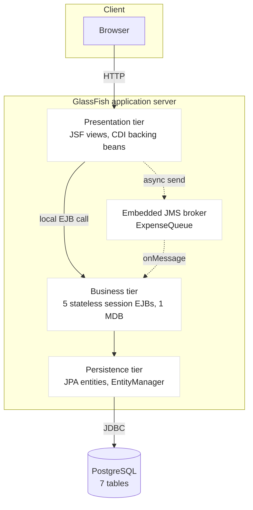
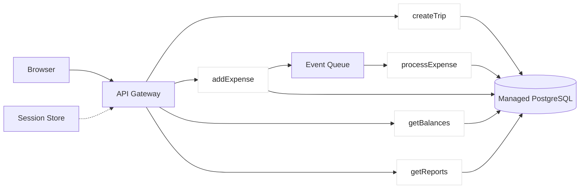

# Part One: Serverless Architectures and Their Role in Enterprise Systems

**A critical evaluation, with TripMate as the running example**

---

## 1. Introduction

This report evaluates serverless architecture as an alternative to the
server-based N-tier design used by TripMate, a group trip planning and expense
tracking system built on Jakarta EE, deployed to GlassFish, and backed by
PostgreSQL. It defines serverless computing, places it against the server-based
model, compares the two across the dimensions that decide an enterprise
architecture, and closes with a balanced judgement on when serverless is
economically superior. The argument is grounded in the published evidence on
serverless economics rather than in vendor claims, and it concludes that the
right answer depends less on which model is newer than on the shape of the
workload.

---

## 2. Serverless Architectures

Serverless computing is a cloud execution model in which the provider manages
provisioning, scaling, patching and availability, and the customer supplies only
code and configuration. The term is a misnomer: servers still run, but the
customer no longer operates them.

The model has two parts. **Function-as-a-Service (FaaS)** executes short-lived,
event-triggered units of code with no persistent process between invocations;
AWS Lambda, Azure Functions and Cloudflare Workers are the canonical examples.
**Backend-as-a-Service (BaaS)** supplies managed components such as
authentication and storage, which an application consumes rather than runs.

Three properties define the model and also bound it.

**Event-driven execution.** A function runs in response to a trigger: an HTTP
request, a queue message, a scheduled event, or a change in a store. This suits
glue code and pipelines, and fits badly a program that expects to be running.

**Statelessness by default.** State lives outside the function, because the
execution environment may be created for one invocation and destroyed after it.
This is what makes horizontal scaling straightforward, and what makes
session-bound interaction expensive.

**Pay per invocation.** Billing is by invocation count and duration, not
provisioned capacity, so an idle workload costs nothing.

**Cold starts** are the widely cited cost: the first invocation after an idle
period must initialise a runtime, and the user sees that latency. Providers have
reduced it for common runtimes but not removed it.

The literature is candid about the limits. Hellerstein et al. argue that
first-generation FaaS, with its short function lifetimes and constrained
bandwidth, is a poor fit for data-intensive computing, and that its
data-shipping model "stymies basic distributed computing" [1]. Jonas et al.
identify the same obstacles but predict serverless will dominate once they are
resolved [2].

---

## 3. The Role of Serverless in Enterprise Systems

Serverless fits enterprise systems where the workload is **variable,
event-driven and decomposable**.

**Variable and bursty traffic** is the clearest case. A system used heavily
during business hours and barely overnight pays for capacity it does not use
under a provisioned model; serverless converts that idle capacity into zero
cost. TripMate is a modest example, used intensively while a trip is being
planned and settled and barely between trips.

**Event-driven pipelines** are the second. TripMate already has one: an expense
is submitted to a JMS queue and written by a message-driven bean, so the browser
is not held while one row and then one row per participant are written. In a
serverless design that consumer becomes a queue-triggered function that scales
independently of the web tier.

**Scheduled and periodic work** is the third: reports and cleanup jobs that are
idle in between, which is precisely what per-invocation billing rewards.

Serverless fits poorly where the workload is **long-running, stateful or
steady**.

TripMate's balance calculation is an example. Query 4 correlates subqueries over
four entities to produce a net position per member. It is database work, and
running it in a function charged by duration that must open a connection each
time is worse than running it where the database already is. The same applies to
**conversational state**: TripMate keeps the signed-in user in an HTTP session,
which a stateless model would push into an external store, adding a hop to every
request for scalability it does not need.
**Steady high-throughput workloads** are the fourth poor fit, because
per-invocation pricing has no volume discount.

---

## 4. Server-Based Architectures

The server-based model provisions infrastructure that runs continuously and is
paid for whether or not it is used. Its enterprise expression is the N-tier
architecture, and TripMate is a conventional instance of it.

*Figure 1: TripMate's server-based N-tier architecture. One long-running
container holds every tier, and the messaging broker runs inside it.*

**The tier boundaries are the point.** The web tier presents and holds no rules.
The business tier holds every rule, so a client cannot bypass one by ignoring
the interface. The persistence tier owns the mapping and the database owns the
data. Each can be changed without the others.

**Transactions are the strongest argument for this shape in TripMate's domain.**
Creating a trip and its administrator membership happens in one container-managed
transaction, which is what makes a trip without an administrator impossible
rather than merely unlikely. Adding an expense writes one row and then a row per
participant in the same transaction, so the splits can never fail to reconcile
with the amount. A serverless decomposition must reconstruct that guarantee
across separate functions, and the standard tools for doing so are more complex
than the transaction they replace.

**Operational cost is the trade.** A running application server must be patched,
its pool tuned and its heap sized. That work is continuous and does not scale
down when nobody is using the system.

---

## 5. Comparison

*Figure 2: the same system, decomposed for a serverless deployment.*

*Each tier boundary in Figure 1 becomes a network hop in Figure 2, and the
transaction that spanned the business tier becomes a distributed one.*

The two figures differ in more than deployment. In Figure 1, four tiers share
one process, one classloader and one transaction. In Figure 2, each business
capability becomes an independently deployed and independently scaled function,
which is what buys the elasticity, and each boundary between them becomes a
network call, which is what it costs.

Two consequences follow directly from that shift. The first is that the
transaction which made a trip and its administrator membership atomic no longer
exists as a single unit of work, so the invariant must be enforced by a saga
with compensating actions or by making each step idempotent and retryable. The
second is that the session, which cost nothing inside the container, now costs a
round trip and a managed store.

Figure 2 is also, deliberately, an honest picture of the good parts. Functions
`addExpense` and `processExpense` communicate through a queue, which is exactly
the pattern TripMate already uses, so that part of the system ports to
serverless almost unchanged. The table below compares the two designs across the
dimensions that decide an enterprise architecture.

| Dimension | Server-based (Figure 1) | Serverless (Figure 2) |
| --- | --- | --- |
| **Cost at low, bursty load** | Pays for idle capacity | Near zero when idle |
| **Cost at steady high load** | Predictable, volume-discounted | Per-invocation, no volume discount |
| **Scaling** | Manual or rule-based, bounded by provisioned capacity | Automatic per invocation, effectively unbounded |
| **Latency** | Consistent, no cold start | Cold starts on first invocation after idle |
| **Transactions** | Container-managed, single node, well understood | Distributed; needs sagas or idempotent retries |
| **State** | In-process sessions are free | Externalised, one network hop per access |
| **Long-running work** | Unconstrained | Bounded by the platform's execution limit |
| **Operations** | Patching, tuning, capacity planning | Provider's responsibility |
| **Portability** | Jakarta EE is a standard; moving containers is feasible | Function APIs and triggers are provider-specific |
| **Vendor lock-in** | Low to moderate | High; the event model is the lock-in |
| **Observability** | One process, one log, one thread dump | Distributed tracing across many short-lived invocations |
| **Best fit** | Steady load, complex invariants, long transactions | Spiky load, independent units of work, event pipelines |

---

## 6. Justification for Serverless Adoption in Optimising Economics

The economic case rests on utilisation, and it is measurable. Adzic and Chatley
studied two early production migrations and found hosting costs fell by between
**66% and 95%**, with the savings coming overwhelmingly from removing idle
capacity rather than from cheaper compute per unit [3]. That is the whole
argument: serverless is cheaper when the alternative is a server running at low
average utilisation.

TripMate's utilisation would be **very low**: a friend group plans a trip for a
few weeks and settles up afterwards, so the application is idle most of the
year, and the saving would plausibly fall in the range those studies report. But
it would not be free. TripMate's value comes from invariants that are cheap to
enforce in one transaction and expensive across functions, and rebuilding them
needs sagas, idempotency keys and compensation logic, incurred once regardless
of scale.

**Serverless is therefore economically superior where the workload is spiky, the
units of work are independent, and the state is already externalised.** It is
inferior where load is steady and high, or where correctness depends on
multi-record transactional guarantees. TripMate sits on both sides, so the
evidence supports a hybrid: serverless at the edges, and a transactional core
holding the invariants.

---

## References

1. Hellerstein, J. M., Faleiro, J. M., Gonzalez, J. E., Schleier-Smith, J.,
   Sreekanti, V., Tumanov, A., & Wu, C. (2019). *Serverless Computing: One Step
   Forward, Two Steps Back.* CIDR 2019. arXiv:1812.03651.

2. Jonas, E., Schleier-Smith, J., Sreekanti, V., Pu, Q., Kashin, S., DeVito, Z.,
   Kulkarni, S., Chen, S., & Stoica, I. (2019). *Cloud Programming Simplified: A
   Berkeley View on Serverless Computing.* arXiv:1902.03383.

3. Adzic, G., & Chatley, R. (2017). *Serverless Computing: Economic and
   Architectural Impact.* Proceedings of the 2017 11th Joint Meeting on
   Foundations of Software Engineering (ESEC/FSE 2017), 884–889.
   DOI: 10.1145/3106237.3117767.

4. Amazon Web Services. *AWS Lambda Developer Guide.*
   <https://docs.aws.amazon.com/lambda/latest/dg/>

5. Microsoft. *Azure Functions documentation.*
   <https://learn.microsoft.com/azure/azure-functions/>

6. Cloudflare. *Cloudflare Workers documentation.*
   <https://developers.cloudflare.com/workers/>

7. Baldini, I., Castro, P., Chang, K., Cheng, P., Fink, S., Ishakian, V.,
   Mitchell, N., Muthusamy, V., Rabbah, R., Slominski, A., & Suter, P. (2017).
   *Serverless Computing: Current Trends and Open Problems.* arXiv:1706.03178.

8. Roberts, M. (2016). *Serverless Architectures.*
   <https://martinfowler.com/articles/serverless.html>

> **Note on citations.** References 1 to 3 and 7 are peer-reviewed or archival
> sources and their details were checked against the publishers' records.
> References 4 to 6 and 8 are vendor or practitioner documentation, which is
> appropriate for describing what a platform does but should not be treated as
> evidence of cost outcomes. Reformat these to whichever citation style the
> assignment requires.
